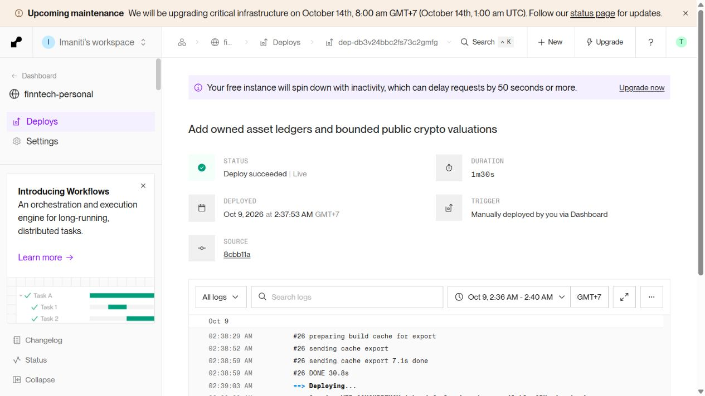
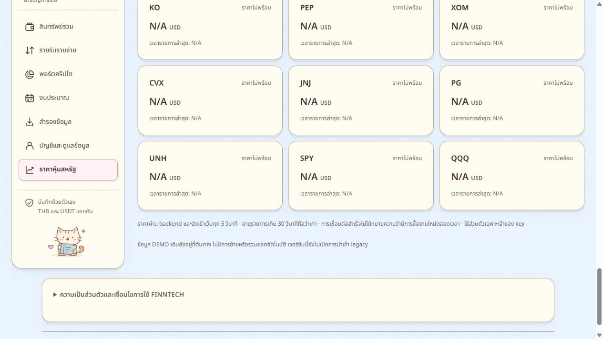

# FINNTECH asset portfolios — deployed 9 October 2026

**Working URL: https://finntech-personal.onrender.com/**

The owner explicitly authorized deployment after the local review. Render reports **Deploy succeeded | Live**, duration **1m30s**, initiated **9 October 2026, 02:37:53 Asia/Bangkok**. This report supersedes the earlier local-only deployment status; it does not change the historical local review results.

## Release and preservation

- Existing Render Free Docker service `finntech-personal`, `srv-db3pcll9fdbs73enrmg0`, Ohio (US East).
- Deployment `dep-db3v24bbc2fs73c2gmfg`, commit `8cbb11af2ce3579338fc3976088b9dd3ab1888e6`, branch `codex/student-real-use`, repository `SABKUSRC69/finntech-beta`.
- Source manifest SHA256 `8d3834d55fa119e4668065dcc598865d124386b16a72c5e47cfdb6c50bafcc34`; 101 runtime files, exactly 24 reviewed paths changed from prior release `8d74df8e3aa2b31310681edc59890b716216241b`.
- Published from the existing isolated release checkout. The owner's working repository was not staged, committed, reset or pushed. Existing work is retained. No dependency version changes, new cloud service, purchase, plan upgrade, public enrollment change, env/secret change or DEMO modification.
- Real database remains `finntech_personal`, role `personal_app`, guarded direct Neon TLS connection and verified real runtime boundary. DEMO database/service remain separate.
- Synthetic acceptance writes used the two preexisting synthetic student accounts only; no owner financial records were changed. Explicitly named synthetic stock portfolios/manual valuations remain for repeatable verification. No automatic cleanup or deletion was introduced.

## Actual checks in this deployment

| Check | Actual result | Exit |
| --- | --- | --- |
| Reviewed release preparation | 24 allowed changes, 101 runtime files; fixtures/private files excluded | 0 |
| Locked dependency installation in isolated checkout | `npm ci --no-audit`, unchanged lockfile | 0 |
| Exact release `npm run tracker:build` | Shared/API/web build passed; JS `index-8239Rq6X.js`, CSS `index-DMR2Ran3.css` | 0 |
| Release/bundle known-secret scan | 103 files; zero known configured secrets found | 0 |
| Encrypted pre-migration database backup | 108,260-byte custom PostgreSQL dump, 108,306-byte AES-256-GCM archive; decrypt byte comparison and `pg_restore --list` passed | 0 |
| Guarded `prisma migrate deploy` | Three reviewed additive migrations applied; all 13 complete | 0 |
| Old dataset preservation across migrations | 12 table row counts/hashes unchanged; no DEMO connection | 0 |
| Isolated release staged diff/commit/push | Exactly 24 reviewed paths; push succeeded | 0 |
| Render build/deploy | Locked install, tracker build, 119-package runtime closure and image publication succeeded; Live | Render succeeded |
| HTTPS acceptance | Ready/database OK, public email-password registration mode unchanged, DEMO/recovery disabled; current assets and local artwork/font served | 0 |
| Original two-account persistence/login/logout | Distinct original owners; original finance/crypto/cash/export arrays unchanged; Decimal expense remains `0.1`; logout/login passed | 0 |
| Live new-ledger acceptance | Fractional AAPL 0.5, cost 51 USD with fee; dated manual THB valuation; backup v3 contains both datasets and no credential patterns | 0 |
| Duplicate submission and owner isolation | Concurrent identical-key buy yields one trade; other owner's data absent from exports; cross-owner correction denied; wrong Origin denied | 0 |
| Render-region actual crypto stream | Authenticated WSS received distinct genuine SOL trades 109.18 and 109.17 USDT; source/quote/time/order retained | 0, part of acceptance |
| Restart persistence | Render recorded “Service restarted by you” at 02:43; both valid sessions, owner mappings, original datasets and new asset records retained afterward | 0 |
| Live browser | Genuine login, persisted AAPL fractional cost display, honest N/A stock prices, manual valuation screens, logout | Browser PASS |
| Live responsive | 320/375/768/1024/1440 × light/dark × assets/crypto/stocks/backup: **40/40**, no page overflow | Browser PASS |

The preceding local implementation already passed root **426**, tracker **281**, isolated PostgreSQL **11**, plus all seven acceptance commands. Those are recorded in [the local review](asset-portfolios-review-20261009.md); they were not all rerun during this deployment. This turn rebuilt the exact isolated release and added the real cloud checks above.

Failed attempts: the initial exact release build exited **1** (`tsc` diagnostics) because that checkout lacked installed Better Auth dependencies; installation from the unchanged lockfile and the subsequent build passed. The initial supplemental cloud acceptance exited **1** on a genuine sign-in **429**, caused by redundant consecutive logins after the successful login/persistence script. The supplemental script now reuses those already validated sessions; authentication rate limits were not changed. Follow-up acceptance passed. Minor browser evidence instrumentation encountered a transient Render “Build not found” dialog after restart; the dialog disappeared, Events recorded the actual restart and subsequent persistence checks passed. No application fix or security relaxation was required for these environment/instrumentation issues.

## Evidence and boundaries

Folder: `asset-portfolios-deploy-evidence-20261009/`. It includes runtime manifest, 24-file release incremental patch, publication identity, sanitized backup/migration results, HTTPS checks, two-account acceptance, genuine public observations, restart persistence, browser DOM/viewport results and screenshots. Raw dump/backup, encryption key, credentials, cookies and account exports stay in ignored private local files and are excluded.

**PASS:** deployed owner-bound ledgers, manual dated assets, preserved old records, v3 export, concurrent retry idempotency, existing registration/login/logout, native Decimal accounting, authenticated regional crypto observations and restart persistence. Local atomic restore/older backup/session-revocation regressions remain covered by the preceding test suite.

**INCOMPLETE / UNCONFIRMED:** public real-time stock feed entitlement and configured source; direct USD/THB; Binance public redistribution entitlement; durable synchronization of the owner's Windows clock. Stock valuation and complete mixed-currency total remain N/A where appropriate; no fake quote, stale threshold change or USD/USDT substitution was introduced. Render clock observations were independently eligible; they do not prove the local Windows Time service synchronized.

**NOT TESTED this deployment:** full restoration of the encrypted PostgreSQL archive, off-device key/archive recovery, live account restore/import, a fresh public signup submission, live stock data during an open market session, load/security audit, corporate actions, physical touch devices or assistive technology. Browser backup download was proven in the local review; this deployment verified actual HTTPS JSON export, without resubmitting a browser restore.

Known unchanged environment limits: Render Free can sleep and has no SLA; email verification and password recovery remain unavailable in the explicitly supported email-password mode. No fake verification/recovery was enabled. Render's locked install again reported **14 dependency vulnerabilities (2 moderate, 12 high)** and Prisma/OpenSSL detection warnings; successful build/DB checks do not establish audit cleanliness. No automatic dependency update was performed.

## Rollback and use

Refresh an already-open tab to load the new hashed assets. Users can sign in or choose **สมัครบัญชี**, then record their own history; records do not execute a trade. Crypto remains USDT, stocks USD, finance/cash THB. Other assets use their explicitly entered native currency and valuation date.

If a rollback is required, the prior Render deployment is available. Keep the additive tables/migrations and backup; do not run down/reset/drop migrations. Prior application code lacks v3 datasets and is not a complete export solution for records entered with this release. No rollback was performed. Auto-deploy remains Off; no paid resource or new integration was enabled.
