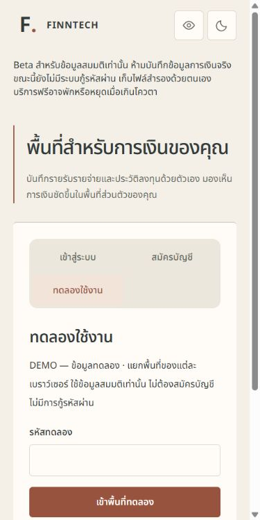
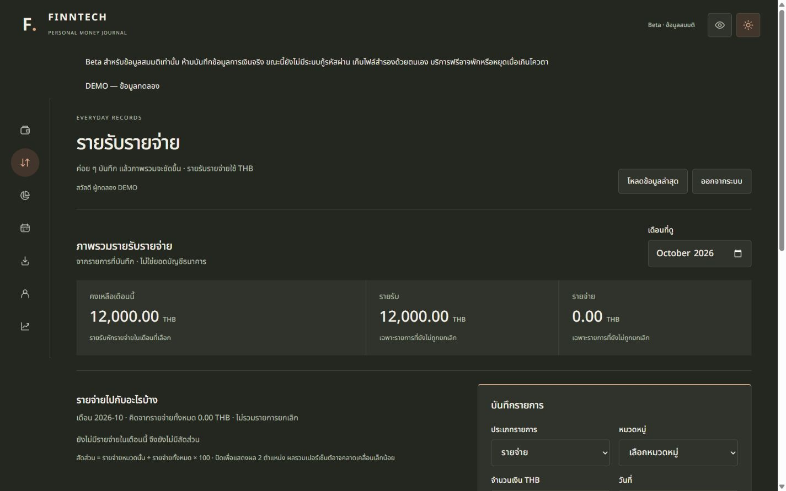
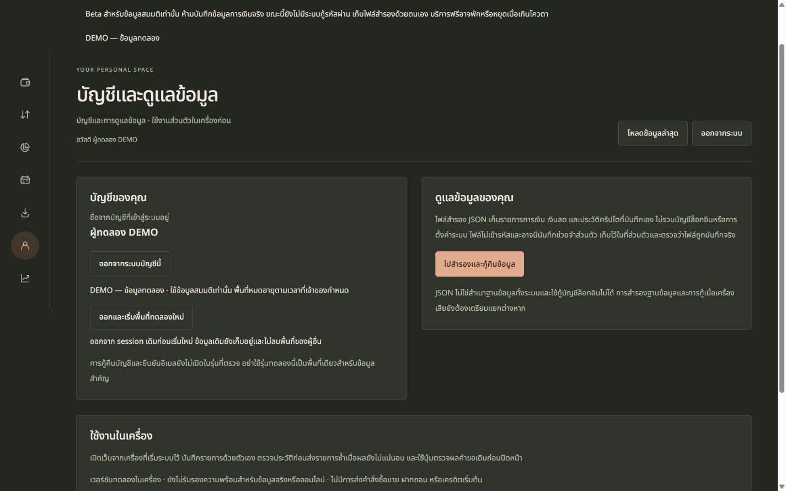

# Shared-access DEMO — Beta deployment acceptance, 8 October 2026

Website: https://finntech-beta.onrender.com/

**LIVE:** `e8caa93e92ca169ffa7759aebd8f4b1d74adc222`, Render deployment `dep-db3b1kcs728c73bu3su0`, existing Free service / Neon Free database. Select **ทดลองใช้งาน**, then enter the code the owner stored directly in Render. No signup form is required. No code, session credential or raw backup is included in this report.

The deployment was authorized by the owner. The original dirty/untracked checkout was preserved; only the separate `.beta-20261007.local/release-source` Git checkout was committed/pushed. No paid resource, redesign, recovery enablement, data deletion or dependency version upgrade occurred. Public signup remains disabled and recovery remains off.

## Implementation and incremental delivery

- Server-only code gate, bounded request bodies/time/rate, configurable retained-account ceiling and fixed workspace expiry. Better Auth **1.7.7** creates genuine users/sessions; no password account or parallel credential store is created.
- A signed browser request cookie maps to a durable transactional receipt. Double clicks, concurrent requests and replay after a lost response return the same session/workspace. A returning valid session resumes without entering the code again.
- Separate synthetic owner and labeled fictional THB records per workspace; empty USDT portfolio. Existing owner/session/ledger/Decimal/THB-USDT-USD rules, HTTP/WS authorization, navigation locks and payload/key retry remain in place.
- Logout and explicit fresh workspace preserve the old dataset. Synthetic recovery is off. No automatic deletion or migration of legacy DEMO data.
- A visible **DEMO — ข้อมูลทดลอง** note remains visible on mobile. Session revocation now bounds the server close handshake by terminating an unacknowledged transport after one second. A raw TCP regression test verifies a peer that deliberately never acknowledges the WebSocket close frame.

The complete incremental implementation patch contains **31 files**, including new source/tests/migration/setup helpers: [demo-shared-access-20261008.patch](demo-shared-access-20261008.patch). The final [release manifest](demo-evidence-20261008/release-manifest-final.json) lists every changed file and hashes all **138** release files. Setup, rotation, disablement, epoch revocation and retention instructions are in [demo-access.md](../operations/demo-access.md).

Release ZIP is retained locally under `.demo-cloud-20261008.local/finntech-demo-20261008-r2.zip`; its 138 extracted files match the manifest. SHA256: `81f2056fceed5b47663781f70481ac83265773be9807d9c34720f6d88881ce6a`. Docker Linux Node 22 image: `sha256:8fb9ab704a73f4f55a8fc59e54f58033c86c0b5b027909567721f3f248f8ef41`.

`@better-auth/core 1.7.7` was already installed transitively and is explicitly declared to use its exported transaction adapter context. No package version was upgraded. Its MIT notice remains in the installed/package runtime license files; no new UI asset/template/service was added.

## Backup, additive migration and data preservation

Before migration, a PostgreSQL **18** official client created a private custom-format dump of the exact existing `beta_app` / `finntech_beta` direct Neon target using TLS `verify-full` and system CA trust. `pg_dump` **exit 0**, `pg_restore --list` **exit 0**; archive **80,697 bytes**, SHA256 `51ae55810fcd7a4287c5f3e7db6f6c56b92000de49f5f2545f66bc73ef7af7c5`.

The dump and archive listing stay private and outside release/public evidence. The old fresh-only migration helper was not used. Guarded Prisma `migrate deploy` **exit 0** applied only `20261008000000_demo_workspaces`: seven completed migrations became eight, all pre-existing table row counts were unchanged immediately after migration, and the new demo table initially contained zero rows. No reset/drop/truncate/data cleanup occurred.

Final read-only aggregate inventory: **12 retained demo workspaces**, **0 demo credential accounts**, **0 demo recovery enrollments**, **0 missing demo owners**, **8 completed migrations**. Verification workspaces are deliberately retained and count toward the default ceiling of 100; they were not silently deleted. See [inventory evidence](demo-evidence-20261008/cloud-database-inventory.json).

## Actual final checks

Counts are per command; overlapping suites must not be added as unique tests. All final commands below exited **0**.

| Command / action | Actual result | Exit |
| --- | --- | ---: |
| `npm test` | PASS — 342 tests / 41 files | 0 |
| `npm run build` | PASS — legacy build | 0 |
| `npm run tracker:typecheck` | PASS | 0 |
| `npm run tracker:test` | PASS — 213 tests: finance 21, contracts 13, API 98, web 81; dev smoke stopped | 0 |
| `npm run tracker:build` | PASS | 0 |
| `node --no-strip-types scripts/tracker-package-smoke.mjs` | PASS | 0 |
| `git diff --check` | PASS; existing CRLF normalization warnings only | 0 |
| `node --env-file=.demo-20261008.local/test.env scripts/demo-test.mjs` | PASS — 13/13 on isolated retained PostgreSQL fixture | 0 |
| Docker build of final 138-file release | PASS — Linux Node 22 / compiled API/web/runtime closure | 0 |
| Compiled Linux DEMO smoke against isolated PostgreSQL | PASS — code gate, protected cookies, concurrency/replay, separate owners, logout | 0 |
| Incremental patch `git apply --check` against saved baseline | PASS | 0 |
| Source/bundle/log/patch secret scan | PASS — 168 files, 11 private values, zero matches | 0 |
| Final release ZIP / published evidence verification | PASS — 138 manifest hashes; zero private values in published files | 0 |
| Private cloud HTTPS/WSS acceptance runner | PASS — 12 checks; 1 combined NOT TESTED item | 0 |
| Separate release commits / pushes | PASS — first release `673dd55`, final fix `e8caa93` | 0 / 0 |
| Render manual deployment | LIVE — final commit verified in dashboard; process exit not exposed | n/a |

Full safe final command logs are `demo-evidence-20261008/cloud-final-*.log`. [Cloud acceptance results](demo-evidence-20261008/cloud-https-results.json) contain no response data/credentials. The isolated database suite covers wrong/missing code/Origin, public-signup and recovery gates, two-owner isolation, Decimal/original-key replay, expiry, logout/fresh, code rotation/disablement, persistent creation ceiling, transactional rollback/no leaked driver errors, bounded bodies/rate, epoch revocation and genuine HTTP/WS session revocation.

## Real HTTPS / WSS and browser evidence

PASS on the deployed site:

- Health/readiness, enabled synthetic-only DEMO, anonymous APIs rejected, exact Origin validation, public signup still rejected, recovery/anonymous bypass endpoints absent.
- Wrong code 403, body overflow 413, missing signed preparation 403. Correct code creates genuine Secure/HttpOnly sessions; request cookie has SameSite=Strict.
- Two independent HTTP cookie jars have different owners. Foreign category mutation is 404; spoofed owner query/header cannot read another dataset. THB Decimal mutation/replay uses the same payload/key; USDT portfolio remains separate.
- Concurrent and lost-response entry replay uses the same session cookie. Browser reload resumes the valid session. UI fresh action logs out and returns an empty code form; no dataset is deleted.
- Downloaded backup is an attachment and parses against the actual backup contract; no credential fields/code/session value. Published HTML/JS/CSS do not contain the code. The code was also absent from visible Render deployment logs; exhaustive provider log-history coverage is NOT TESTED.
- WSS market/stocks accept authenticated sessions and reject anonymous upgrades. After logout: HTTP is 401, receipt replay is 410, **both new WSS upgrades are 401**, no market messages arrive after the revalidation allowance, and both previously opened client connections close. Final observed client closure: **22,723 ms after completed logout**.
- Browser overview at 320/390/768/1280/1440px in both light/dark: 10/10 measurements without page overflow; DEMO note visible in all. [Width evidence](demo-evidence-20261008/cloud-browser-widths.json). Full previous local entry/account matrix remains in the preparation report; physical devices were not tested.

Screenshots contain only synthetic data:

## Earlier failures and their interpretation

The initial deployment was LIVE at `673dd55`, but the cloud runner's **14-second client-close assertion failed, exit 1**, on Windows and in a Linux client. HTTP revocation and receipt replay rejection had already passed. A longer observation showed both WSS clients stopped receiving messages and eventually closed with code 1006, approximately 20 seconds after logout; a new handshake was immediately 401. The exact source of this external close delay remains **UNCONFIRMED**; it is not proven to be a Render defect or a Better Auth failure.

The final implementation bounds server transport shutdown after the close frame (new unacknowledging-peer regression), and the final cloud runner distinguishes authorization/data revocation from client-visible transport closure: no post-revalidation messages, new upgrades 401, and eventual close within a 35-second observation window. The five-second session revalidation and **30-second market stale threshold are unchanged**. Final cloud run passed, observing 22,723 ms. The earlier result is retained in [first release failure evidence](demo-evidence-20261008/cloud-https-first-release-failure.json); [safe observation timestamps](demo-evidence-20261008/cloud-ws-diagnostics.json) record the longer investigation.

A first attempt at the new raw TCP regression used `node:test` in the Vitest suite; it produced “No test suite found,” exit 1, with 97 existing API tests passing. The import was corrected to Vitest; no assertion was removed. Final API count is 98, tracker 213, root 342. Earlier preparation failures and environment limitations remain in [the preparation report](demo-shared-access-20261008.md).

## NOT TESTED / limits and operational handoff

- Waiting for natural four-hour expiry on the production site; forced expiry and expired-session replay PASS in the isolated real database suite. Production code rotation/epoch change was deliberately not exercised against visitors; both have isolated HTTP/WS PASS evidence.
- Render 15-minute idle/cold wake, free quota exhaustion, multiple instances/distributed rate limiting, large concurrent public load. The current rate limiter is per-process global, 30 demo requests/minute; durable account cap is database-wide. No automated keep-alive or paid upgrade was added.
- Two independent physical browser profiles/devices and real browser network-loss injection. Cookie jars prove owner separation; UI/HTTP tests prove replay semantics. Physical touch/screen reader/full-screen UX re-audit is NOT TESTED.
- Existing real-account credentials were not reused for cloud login; regular synthetic login remains PASS in isolated PostgreSQL. Real-data readiness and recovery remain outside scope.
- Provider-side exhaustive secret/log history scan and runtime advisory audit are NOT TESTED. Docker's full build install reports the existing **14 npm advisories (2 moderate, 12 high)**; a successful build is not an advisory audit. No dependency versions were changed to hide these.
- Tested archive readability is not a full database restore drill. Keep the private pre-migration dump; do not publish it.

Owner settings are complete. To stop new entry, set `FINNTECH_DEMO_ENABLED=false` and restart/deploy; existing sessions survive. Rotating only the code also preserves existing sessions. Change `FINNTECH_DEMO_SESSION_EPOCH` to revoke prior demo workspaces on HTTP/WS without revoking normal accounts. Retained expired/logged-out workspaces still consume capacity; no automatic deletion exists. Review a retention plan before any deletion.

Only the fixture PostgreSQL and ephemeral operator/client containers started for this work were stopped; the fixture volume and data remain. Ports 4175/4199/5443 are not listening. Three agent-created temporary operator files containing the demo test input/session cookies/backup password were removed after verification; the private verified dump and the owner's original environment files remain. Docker Desktop was left running; unrelated services, owner DBs and volumes were not stopped or removed. This completes this DEMO delivery and stops for review; it does not certify FINNTECH as complete or ready for real financial data.
