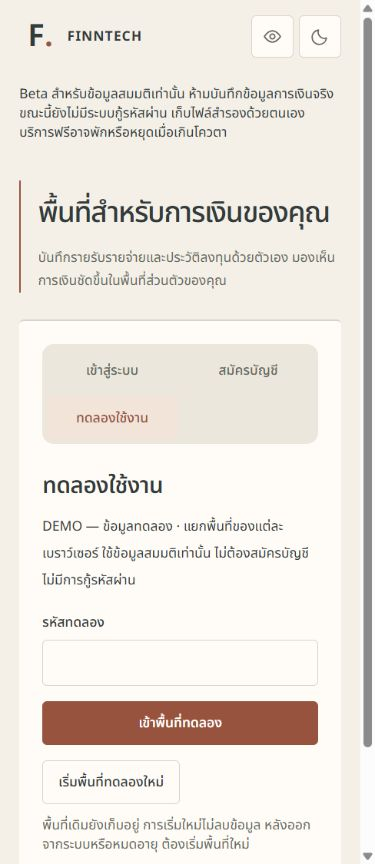
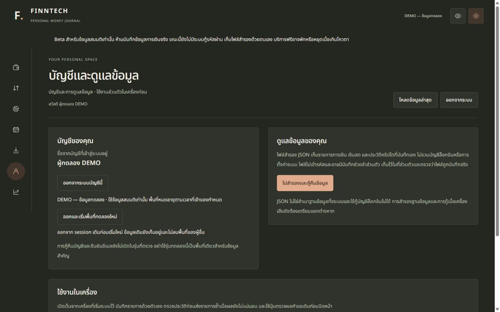

# FINNTECH shared-access DEMO — 2026-10-08 (Asia/Bangkok)

This is the **historical preparation checkpoint**, before owner secret entry and deployment. The Beta is now LIVE; use [the deployment acceptance report](demo-cloud-deploy-20261008.md) for the current result: root **342**, tracker **213**, PostgreSQL **13** passing, real HTTPS/WSS acceptance passing, and the final **31-file** incremental patch / **138-file** release. The counts, initial image and ZIP below record the original preparation run.

At that preparation checkpoint, implementation and isolated release verification were complete, but the public Beta had not yet been updated; owner secret entry, cloud backup/migration and HTTPS/WSS acceptance were still pending. Signup settings remain unchanged after deployment.

## Change and baseline

- Incremental patch: `demo-shared-access-20261008.patch` includes **30** modified/new implementation, test, fixture and setup files, including the additive SQL migration. No root checkout commit, push, schema reset, DB deletion, dependency-version upgrade, redesign or paid service was performed.
- Every modified deployed file was byte-compared to the saved owner baseline and the previous isolated release at **2def6a6d4bb690ce28107c8bb3710390930edba9**. The patch dry-run applies to a separate saved-baseline tree. Existing tracked/untracked work is preserved; no cleanup/reset/staging was used.
- Release snapshot: **137 allowlisted source files**, no `.git`, secrets, env files, private evidence, generated output or node_modules. Manifest and changed-file list: `demo-evidence-20261008/release-manifest.json`.
- Prepared ZIP: `.demo-20261008.local/finntech-demo-20261008.zip`, SHA256 **C94F078715EC50F882E41154E3F6A3BD7BF214311A92929CE9EBEAA59708BC5A**.
- Final Linux image: `finntech-demo:20261008`, ID **sha256:cd8aad6410fdff281e04bf5f2885e7dff3f4ef8c9e8bbc3aeda3ce36d4231de7**; production runtime closure remains **119 packages**.

## Behavior

The server-only code gates a Better Auth custom endpoint. Better Auth **1.7.7** creates genuine users/sessions through its existing Prisma adapter and signs cookies through `setSessionCookie`. Each browser's signed HttpOnly request cookie maps to a durable receipt, separate synthetic auth user and VERIFIED tracker owner. No shared financial account, demo password store, generated user password, account linking, recovery enrollment or direct anonymous-signin route is added.

The existing package **@better-auth/core 1.7.7 (MIT)** is explicitly declared as a direct dependency to use its exported `runWithAdapter`. Its installed version already existed; package-lock changes only declare that dependency. Its transaction context is necessary: simply constructing a scoped adapter does not override Better Auth's ambient HTTP adapter. One transaction now contains the user, session, owner mapping, seed and receipt. A simulated post-seed failure rolls them all back together.

Only labeled fictional THB income/categories and an empty USDT portfolio are seeded. Existing Decimal/ledger calculations, ownership, normal auth, HTTP/WS authorization, finance-write payloads/idempotency keys and 30-second market freshness rules remain unchanged. No USD/USDT conversion or invented market performance is added.

DEMO has a fixed lifetime independent of session refresh. Double submission and lost-response retry reuse the original persistent receipt/session, including runtime recreation. Logout/expiry cannot be undone with the old receipt. Fresh entry confirms logout and replaces only that browser's request cookie; old datasets remain retained. The new button obeys existing navigation/pending locks. Unknown entry outcomes preserve the same in-memory code and prevent mode changes/reset until reconciliation; code is not stored in browser storage or URLs.

The entry can be disabled; code rotation preserves existing sessions. Changing the session epoch revokes only demo subjects through HTTP/get-session and both WS streams. This behavior and limits/retention are documented in `../operations/demo-access.md`.

## Actual checks

Final exits below are from actual executions; initial failures and testing limits are listed separately. Evidence logs are in `demo-evidence-20261008/`.

| Command / check | Result | Exit |
| --- | --- | --- |
| `npm test` | **PASS** 341 tests / 40 files | 0 |
| `npm run build` | **PASS** legacy build preserved | 0 |
| `npm run tracker:typecheck` | **PASS** all workspaces | 0 |
| `npm run tracker:test` | **PASS** 212 tests: finance 21, contracts 13, API 97, web 81; dev-web smoke stopped/released its port | 0 |
| `npm run tracker:build` | **PASS** shared/API/web compile | 0 |
| `node --no-strip-types scripts/tracker-package-smoke.mjs` | **PASS** Decimal, exact arithmetic, imports and ledger checks | 0 |
| `node --env-file=.demo-20261008.local/test.env scripts/demo-test.mjs` | **PASS** 13 PostgreSQL/Better Auth/HTTP/WS integration tests; forward migration only | 0 |
| `node scripts/demo-release-prepare.mjs` | **PASS** saved/deployed baseline comparison, 30-file patch, 137-file release | 0 |
| `git apply --check` to separate saved-baseline tree | **PASS**, no application to owner checkout | 0 |
| Linux `docker build` from isolated snapshot | **PASS** clean npm ci, generate, build and runtime closure | 0 |
| Final Linux actual Docker CMD smoke | **PASS** health/readiness/SPA/deep link 200; anonymous `/api/me` 401; API miss 404 JSON | 0 |
| Final compiled Linux DEMO fixture smoke | **PASS** wrong code, real signed session, concurrent/replayed entry, separate owners and logout/replay rejection | 0 |
| Secret / manifest scan | **PASS** 166 release/bundle/log files scanned against 10 known private values, zero matches; release hashes match | 0 |
| Prepared ZIP hash verification | **PASS** all 137 archive contents match the reviewed manifest | 0 |
| `git diff --check` | **PASS** owner checkout defaults; no whitespace fixes to unrelated owner work | 0 |

The Linux DEMO smoke constructs an explicitly scoped **synthetic fixture** runtime using compiled image modules. It is not proof that the public Render service has been configured or that the code has passed over HTTPS. The actual CMD test uses the isolated fixture DB with demo disabled; the compiled fixture separately exercises demo behavior on the same image.

Lifecycle cleanup **PASS / exit 0**: the owned synthetic Node server, both owned image containers and the dedicated PostgreSQL fixture were stopped after checks. Ports **4199/5443** were verified released; the fixture volume and test data remain retained. Docker Desktop and unrelated owner services were not stopped.

### Integration coverage (13/13 PASS)

1. Wrong/missing code, missing signed prepare cookie, forged Origin, paused public signup, unsupported anonymous/recovery routes and direct anonymous API access rejected.
2. Concurrent entry and a lost session-cookie response replayed after runtime recreation produce one workspace/session. No credential account/password or recovery row is created.
3. Two independent client cookie jars resolve to different owners. Foreign category modification and spoofed owner headers/query do not cross ownership; same finance payload/key returns its original receipt and THB/USDT remain separate.
4. A separate regular synthetic account still logs in normally, stays isolated and cannot be replaced by demo entry while its session is valid.
5. Code rotation and entry disable leave existing sessions valid while stopping entry as configured.
6. Fixed workspace expiry denies HTTP/get-session/replay without renewal or new creation.
7. Better Auth session expiry itself denies reads and entry replay.
8. Logout invalidates the session; explicit fresh entry creates a distinct owner and leaves both prior datasets intact.
9. Concurrent final-slot entry respects the database-wide lifetime ceiling, which persists across runtime recreation.
10. Injected post-seed error rolls back auth/session/owner/finance/receipt and withholds code/DB secrets from response/logs.
11. Oversized bodies and the global rate ceiling reject abuse without account creation.
12. Session epoch revocation rejects HTTP and closes market/stocks WS through normal revalidation (tests completed in about 5.1 seconds, under the 12-second deadline).
13. Actual Better Auth logout closes an already-open demo WS and preserves its finance dataset.

Unit/React regressions also prove a bounded stalled upload, exact code/config validation, pending/double-click guards, unchanged retry payload, returning-session resume, in-memory-only code and fresh/logout navigation locks.

## Actual browser evidence

Compiled app served on **http://127.0.0.1:4199** using only synthetic PostgreSQL **127.0.0.1:5443 / finntech_demo_test_20261008 / demo_fixture**. No real owner credentials/data were used.

- Correct code entered the DEMO workspace; reload resumed it; a wrong code showed the rejection; keyboard Enter submitted entry/fresh and keyboard Tab reached Backup.
- Fresh invoked existing logout and returned to the code form. Pending UI visibly disabled navigation/logout/backup during the operation.
- Entry and account pages: widths **320 / 390 / 768 / 1280 / 1440**, **light and dark**, measured **no page horizontal overflow**. Results are in `browser-evidence.json`. This scoped verification does not re-certify every existing screen or physical touch device.
- Screenshots contain synthetic UI only; no input code or hosting secret screenshot is published.

## FAIL / fixed initial attempts

- Initial DB run: **10 passed / 1 failed, exit 1**. Post-seed fault exposed separate Better Auth user/session commits; explicit ambient transaction-adapter binding fixed it. The affected rows were confined to this synthetic DB and were retained; no deletion was used to hide the failure.
- Stalled-body regression initially failed (**API 96 passed / 1 failed, exit 1**): cancelling the reader resolved `read()` before the timeout rejection. Rejecting the deadline before cancellation fixed the real race; final suite passed with the assertion intact.
- Typecheck initially caught frontend mode typing and test-fixture variable/import errors (**exit 2**); corrected without weakening types/assertions.
- First root test discovery found saved baseline and previous release copies: **456 assertions passed but 14 artifact test files failed imports, exit 1**. Root config now excludes `**/*.local/**` in addition to Vitest defaults. Product source tests/assertions remain; final `npm test` passes 341 tests.
- Initial restricted tracker test run hit **EPERM realpath** before executing tests (**exit 1**, environment failure). Authorized network/process-capable execution passed. Initial Docker startup lacked its daemon/WSL access; starting the installed Desktop runtime with authorized execution resolved it. No owner DB/process cleanup was used.
- Linux clean `npm ci` still reports **14 dependency-tree vulnerabilities (2 moderate, 12 high)** while exiting 0. This is **not an audit PASS**. No versions were upgraded to conceal/change that finding. A fresh advisory audit of the 119-package deployed runtime closure is **NOT TESTED** in this task.

## NOT TESTED / pending release

- New feature on actual **https://finntech-beta.onrender.com**, TLS Secure-cookie transport, public WSS, Render sleep/recovery and quotas.
- Two separate Chrome/Edge profiles performing the entire UI flow. Independent cookie-jar isolation is verified at the real DB/HTTP boundary; the visible browser used one profile.
- Browser network-loss simulation, physical mobile/touch, screen readers and all-screen UX re-acceptance. Unknown-outcome behavior is covered by React regression and HTTP/DB replay tests.
- Existing recovery integration re-acceptance on its separate prior fixture; cloud synthetic recovery remains off.
- Private backup/forward migration of the existing Neon Beta DB, push/deploy, and real shared-code setup. These are pending the owner secret step. The new runtime requires the additive table; do not deploy it against an unmigrated target.
- Automated workspace retention/deletion: deliberately absent pending a reviewed retention plan. Expired workspaces count toward the configured lifetime ceiling.

## Handoff

The owner may open Render's **finntech-beta → Environment → Edit**, enter `FINNTECH_DEMO_ACCESS_CODE` directly (12–128 characters; prefer 16+ random), add `FINNTECH_DEMO_ENABLED=true`, and select **Save only**. Optional limit/TTL/epoch defaults and revocation instructions are in the setup guide. Keep all existing signup/recovery/DB/origin secrets unchanged. Do not send the code or a screenshot of values through chat. After that, the prepared release can proceed through private DB backup, reviewed additive migration, deploy and actual HTTPS/WSS acceptance.
