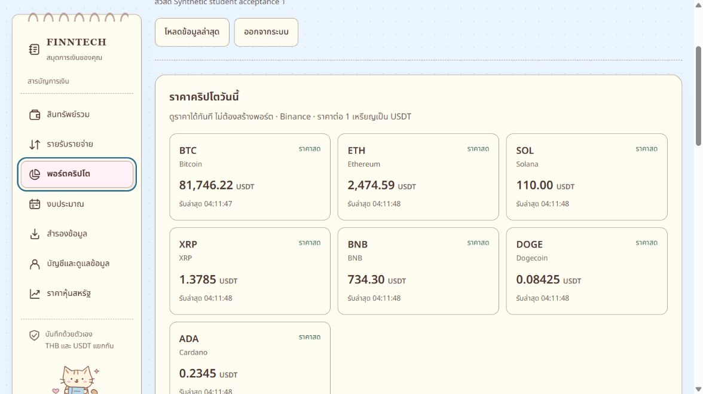
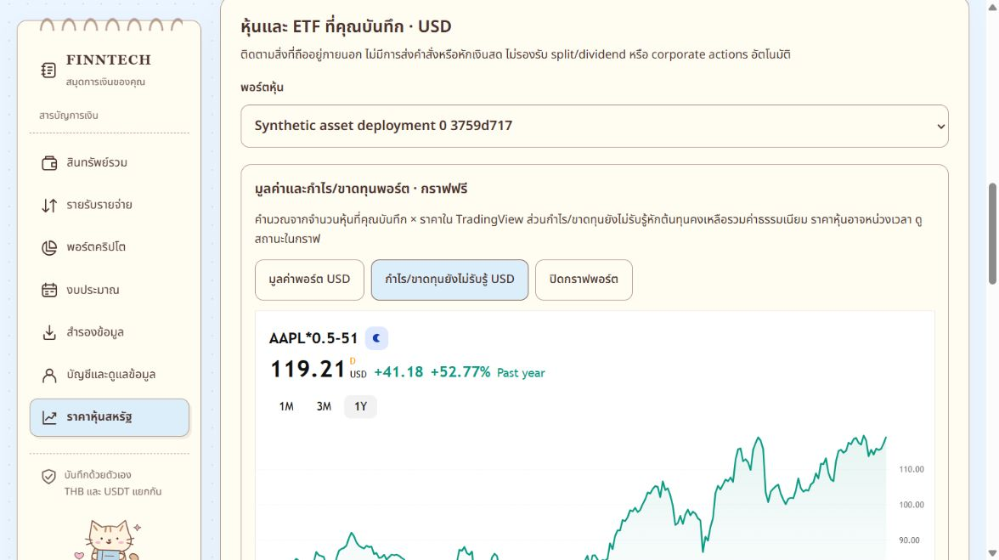
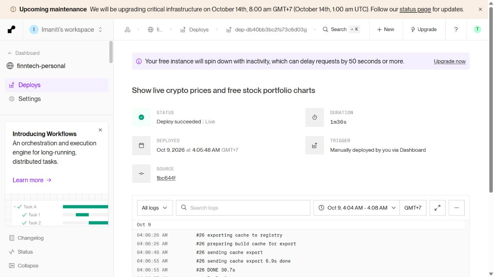

# ราคาคริปโตและกราฟหุ้นฟรี — 9 ตุลาคม 2026

ขึ้นออนไลน์ที่ [FINNTECH Personal](https://finntech-personal.onrender.com/) แล้ว
Render Free service `srv-db3pcll9fdbs73enrmg0`, Ohio, deploy
`dep-db40bb3bc2fs73c6d03g` แสดง **Deploy succeeded | Live**, ใช้เวลา 1m30s
เริ่ม 04:05:48 Asia/Bangkok จาก commit `1bc644fc25982c173746b463d720a450c46081f9`
branch `codex/student-real-use` ใน repository เดิม ไม่มีการซื้อบริการหรือเพิ่ม API key

## สิ่งที่แก้

- เพิ่มแผงราคาต่อเหรียญ BTC, ETH, SOL, XRP, BNB, DOGE, ADA ในหน้าพอร์ตคริปโต แม้ยังไม่เลือกหรือสร้างพอร์ต
- ใช้ API/stream Binance public เดิม แสดงเวลาและสถานะจริง ราคาเก่าไม่ใช้ประเมินมูลค่าปัจจุบัน ไม่มีราคาสมมติ
- หน้าหุ้นมีกราฟราคา AAPL, MSFT, NVDA, AMZN, GOOGL, TSLA, SPY, QQQ ฟรีจาก TradingView ไม่ต้องสมัครหรือใส่ key
- เลือกพอร์ตหุ้นแล้วเปิดกราฟมูลค่า USD หรือกำไร/ขาดทุนยังไม่รับรู้ USD ได้ ราคาคูณจำนวนที่ถือ หักต้นทุนคงเหลือรวมค่าธรรมเนียม
- หน้าสินทรัพย์รวมมีกราฟหุ้นที่รวมจำนวนจากหลายพอร์ต โดยรวมหลักทรัพย์ซ้ำให้เหลือหนึ่งพจน์
- ซ่อนกรอบราคา Alpaca ที่ไม่พร้อมและข้อมูล N/A ซ้ำในหน้าหุ้น ต้นทุน จำนวน ประวัติ และกำไรรับรู้ที่บันทึกยังอยู่ครบ

## ความเป็นส่วนตัวและข้อจำกัด

กราฟราคาหุ้นทั่วไปส่งเฉพาะสัญลักษณ์สาธารณะและการตั้งค่ากราฟ ไม่มีจำนวน ต้นทุน บัญชี หรือ session
กราฟพอร์ตโหลดหลังผู้ใช้กดยินยอมส่งสัญลักษณ์ จำนวน และต้นทุนรวมให้ TradingView เท่านั้น
การยินยอมผูกกับสูตรปัจจุบัน เปลี่ยนจำนวน/ต้นทุนหรือเปลี่ยนพอร์ตต้องยินยอมใหม่
ซ่อนยอดเงินจะถอด iframe ของกราฟพอร์ต และปิดกราฟได้
URL ใช้ `no-referrer` และรักษา attribution ของผู้ให้บริการ
TradingView อาจได้รับ IP และข้อมูลการเรียก widget ตาม [เอกสารผู้ให้บริการ](https://www.tradingview.com/widget-docs/faq/general/)

หุ้นอาจหน่วงเวลา ในการตรวจ AAPL มีเครื่องหมาย D และสถานะ Post-market
ค่าที่กราฟแสดงยังไม่ส่งกลับมารวมกับยอดสินทรัพย์ THB ในระบบ
Alpaca API เดิมยังเป็น NOT_CONFIGURED และไม่มี key จึงไม่อ้างว่าการประเมิน native ของหุ้นพร้อมแล้ว
กราฟย้อนหลังใช้จำนวนหุ้นวันนี้ตลอดช่วง ไม่ใช่ประวัติมูลค่าพอร์ตจริง
เปอร์เซ็นต์เปลี่ยนแปลงของกราฟไม่ใช่ผลตอบแทนเทียบต้นทุนของผู้ใช้
Free hosting อาจพักเมื่อไม่ได้ใช้ และ external widget อาจไม่โหลดในบางเครือข่าย มีลิงก์ TradingView ให้เปิดโดยตรง

## ผลตรวจ

| การตรวจ | ผล |
| --- | --- |
| Root test suite หลังแก้ runtime และเพิ่ม privacy test สุดท้าย | 434 tests / 56 files ผ่าน |
| Tracker suite ก่อนการปรับข้อความ holdings รอบสุดท้าย | 288 tests ผ่าน |
| Web suite หลังปรับ holdings | 118 tests ผ่าน |
| Portfolio privacy/math suite หลังเพิ่ม hidden-iframe test | 4 tests ผ่าน |
| Tracker typecheck และ tracker build | ผ่าน |
| Build ใน isolated release checkout | ผ่าน |
| Legacy build, package smoke, diff check | ผ่าน |
| ตรวจ secrets ใน 9 ไฟล์และ assets 2 ไฟล์ | ไม่พบ secrets ที่ตั้งไว้ |
| Production readiness | HTTP 200 |
| Production assets | SHA-256 ของ JS/CSS ตรงกับ isolated bundle ทั้งคู่ |
| Production crypto market | HTTP 200, ทั้ง 7 ตัว LIVE/TRADE มี observedAt และ receivedAt |
| ข้อมูลการเงินบัญชีสังเคราะห์เดิมสองบัญชี | hash ของ financial arrays ทั้งหมดเท่ากับก่อน deploy |
| Browser widget ราคาจริง | AAPL 340.42 USD, มูลค่า 0.5 หุ้น 170.21 USD, หักต้นทุน 51 USD เหลือ 119.21 USD |
| Production browser ด้วยบัญชีสังเคราะห์เดิม | เข้า FINNTECH ปกติ เห็นคริปโต LIVE ครบ 7 ตัว, AAPL 340.42 และกราฟพอร์ต 170.21 / 119.21 USD |
| กราฟค่าติดลบสังเคราะห์ | สูตรต้นทุน 201 USD แสดง -30.79 USD |
| Browser hide balances และธีมมืด | กราฟพอร์ตหายเมื่อซ่อนยอด และ widget โหลดธีมมืดได้ |

หลัง restart ทดสอบครั้งแรกตลาดคริปโตยังเชื่อมต่อไม่ครบ จึงไม่ผ่านเงื่อนไข LIVE ทั้งหมด
เมื่อเชื่อมต่อสำเร็จตรวจซ้ำเวลา 04:08:28 Asia/Bangkok ผ่านทั้งเจ็ดตัว
ไม่ได้อ้างว่าคำขอราคาแรกทันทีหลัง cold start จะมีราคาทั้งหมดเสมอ
การลอง viewport 375×812 ผ่าน capability ไม่เปลี่ยน viewport จริง (ยัง 1265px)
จึงยังไม่อ้างว่าได้ตรวจมือถือด้วยภาพจริงในรอบนี้ CSS ใช้ grid responsive และ iframe width 100% ตาม container

## หลักฐานและขอบเขตการเผยแพร่

เผยแพร่เฉพาะ runtime 9 ไฟล์จาก clean checkout แยก ไม่มีการ commit งานอื่นใน working repository
ไม่มี migrations, dependency updates, database resets, เปลี่ยน credentials หรือแก้รายการการเงินของผู้ใช้
การตรวจ production ใช้บัญชีสังเคราะห์เดิมตามอนุญาต session ส่งเฉพาะ FINNTECH origin
การตรวจ browser ใช้การเข้าสู่ระบบปกติด้วยบัญชีสังเคราะห์เดิมที่ FINNTECH แล้วออกจากระบบเมื่อเสร็จ
บันทึกและ source manifest ส่วนตัวอยู่ใน `.free-market-20261009.local` ซึ่งถูก ignore
ไม่มี session/password/exports เผยแพร่ไป GitHub หรือ TradingView

Bundle: `index-BKBy87H2.js` SHA-256 `59ed5d6bc12462eee6269d3a5d258b4d63c552af63a69f31da67a005163f1b72`
และ `index-BUgV_W5t.css` SHA-256 `238811ded721d691e327e7c0434bbc47228361098af6eb1f4ad49ed101a8388c`
