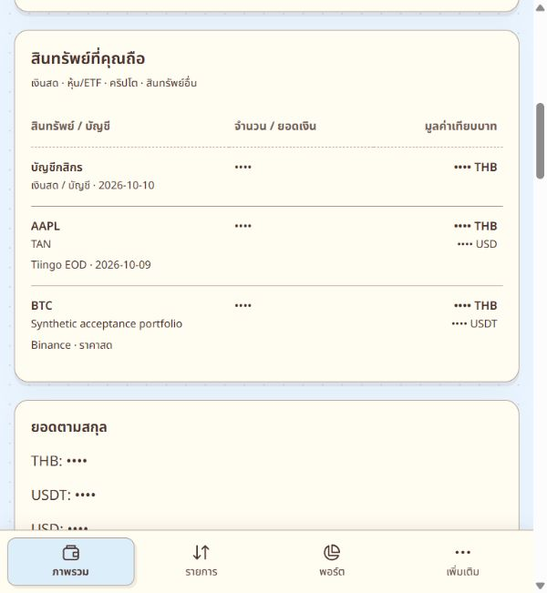
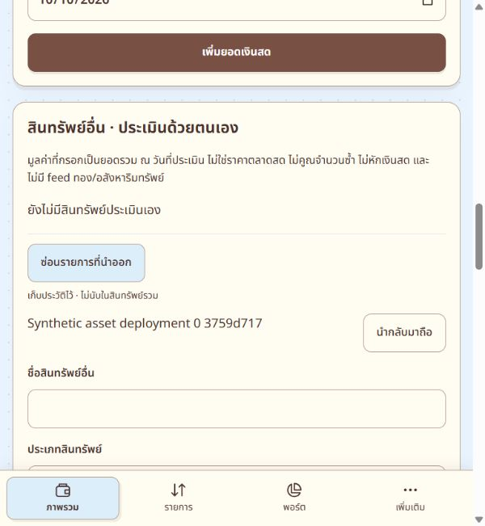

# Manual asset removal — 10 October 2026

The user requested removal of the circled manual valuation named `Synthetic asset deployment 0 3759d717`, with unit `รายการสังเคราะห์`, from the selected central account. The 9 October deployment report explicitly records synthetic manual valuations retained after acceptance checks. The live owner mapping and exact name/unit/date/cost/quantity matched that record. Its valuation had already been changed to zero, version 2, before this task.

Direct deletion was refused by the existing asset-history database trigger. Those transactions rolled back. The guard was preserved. An encrypted local backup of the exact record was saved and decrypted successfully; private credentials and backup remain in ignored local storage.

## Published change

- Commit `99dc4a621c9fbc94da418431c4dbc96e06b08573`, branch `codex/student-real-use`, repository `SABKUSRC69/finntech-beta`.
- Render service `srv-db3pcll9fdbs73enrmg0`, deployment `dep-db4m9cvlot8c73bj1600`: **Deploy succeeded | Live**.
- Additive migration `20261010050000_archive_manual_assets` adds `manual_assets.archived`, default false. Existing manual asset fields and cash rows were unchanged across migration.
- Owner-bound, version-checked, idempotent status changes keep the record and audit history. Archived assets are excluded from holdings and totals; a collapsed list provides a restore action. Editing an archived record is refused. Status is included in backups and restored with the record; earlier backups omit it and remain active by default.
- The exact user-requested manual asset was archived through the authenticated live UI, version 2 → 3. No other synthetic records were removed.
- The eight-file release patch was also applied to the user's working checkout while preserving existing pending edits. The root checkout was not staged, committed, or pushed.

## Actual verification

- Shared contracts/API compilation and production web build passed. The first sandboxed web bundling attempt could not resolve Vite through its config runner; the subsequent approved build succeeded.
- Full `tracker:typecheck` passed. No test suite was added or run.
- Before/after fingerprints confirmed all cash accounts, stock/crypto portfolios, trades and holdings, finance transactions, and other manual assets unchanged across removal.
- The exact record remains archived in the database; all original record fields were retained. A real owner backup export passed its accounting consistency checks and included the archived status.
- Live UI displayed success, zero active manual assets for this account, and `รายการที่นำออก (1)`. The held-assets table no longer contains the manual synthetic unit.
- The restore control was observed; no live restore was submitted because the user requested this item remain removed.
- Screenshots were captured with amounts hidden. Normal amount visibility was restored afterward; the temporary Render tab was closed.

