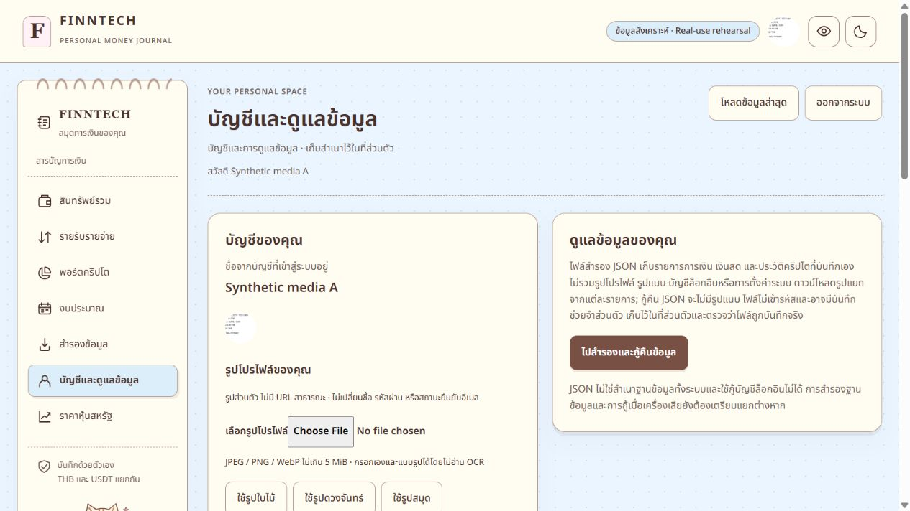
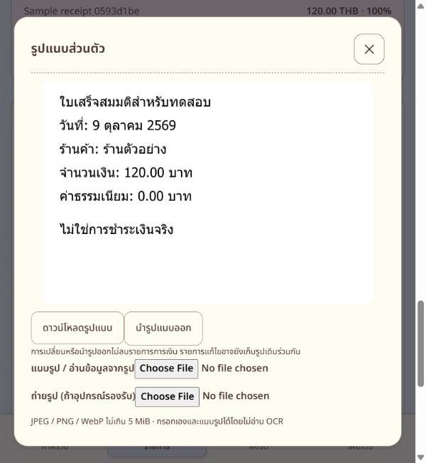

# FINNTECH private media review — 2026-10-09

**Local implementation and acceptance complete. No commit, push, live migration or deployment.** All images/accounts used for tests are fictional. Existing finance, crypto, stocks/ETF, manual assets, free market refresh and notebook design were preserved. The pre-existing dirty/untracked workspace was captured before edits; the delivery patch is relative to that task baseline, not Git HEAD.

| Feature | Implementation | Verification | Remaining limits |
|---|---|---|---|
| Receipt image + assisted entry | Implemented in finance and historical crypto/stock forms, private attachment history/download/replace/remove | Actual Thai/English OCR and browser review; explicit save with image; parser, cancellation, unknown writes, owner isolation, atomic ledger/link and correction tests passed | Accuracy varies; no payment verification, physical camera or slow-phone guarantee |
| Custom avatar | Implemented square crop/position, presets, initials, private PostgreSQL persistence and header/card update | Browser upload/crop/save, preset replacement, explicit removal, reload, server/DB restart and logout/login across accounts; stale/uncertain response tests passed | No public profile or shared URL |

## Final commands and exit codes

| Check | Exit | Evidence |
|---|---|---|
| `npm test` | 0 | 456 tests / 62 files |
| `npm run tracker:test` | 0 | finance 25, contracts 16, API 131, web 139; Vite/React package smoke passed and released port 4175 |
| `npm run tracker:typecheck` | 0 | All four tracker packages |
| `npm run tracker:build` | 0 | Shared packages, API and production web |
| `npm run build` | 0 | Legacy root build preserved |
| `node scripts/prepare-ocr-assets.mjs --offline` | 0 | Pinned versions and language SHA256 checks |
| `node scripts/media-runtime-smoke.mjs` | 0 | Ten synthetic PostgreSQL acceptance scenarios, plus wrong-owner removal/anonymous write/remote-reference rejection |
| `node scripts/media-lifecycle-smoke.mjs` | 0 | Fresh forward migration; complete restore evidence; negative constraint mismatch; restricted purge; actual pg_dump/restore + deletion replay; PostgreSQL restart |
| `node scripts/media-ocr-smoke.mjs` | 0 | Real LSTM Thai/English engine, fictional receipts |
| `docker build -f Dockerfile.real ...` | 0 | Node22 Debian runtime with installed Sharp native optional packages |
| Linux runtime normalization | 0 | Actual JPEG/PNG/WebP decoding, JPEG re-encoding, metadata stripping, invalid payload and decoded pixel cap under a 256 MiB container memory limit |
| `git diff --check` | 0 | Existing tracked diff; LF/CRLF advisories only |

Incremental-patch application and whitespace validation are recorded in `media-review-artifacts.json`. The upstream CORE-LICENSE.txt is preserved byte-for-byte, including its final blank line, and is the sole whitespace-check exception. Private detailed logs remain in the ignored local test folder; public summarized results contain no credentials, cookie, raw personal OCR, staged image exports or owner financial data.

Browser checks used exactly 320/375/768/1024/1440px, light/dark, for entry/review and avatar screens. Page width stayed within viewport; previews cap at 480×360, avatar crop 192px and displayed avatar 44px. File-picker buttons/ranges use at least 44px height. Escape dismissed the receipt modal and returned focus to its original history button. Browser OCR cancellation displayed cancellation and retained manual attachment controls. Hiding amounts hid receipt/OCR content; original pending-write locks remain independent of OCR. A separate integration test prevents header logout during unresolved media writes.

## Measured OCR and storage

| Actual browser run | Preprocessing | OCR |
|---|---:|---:|
| English, 375px viewport | 31 ms | 578 ms |
| Thai, 375px viewport | 29 ms | 469 ms |
| English retry, 1440px | 31 ms | 434 ms |

These are warm local assets on desktop hardware at responsive viewport sizes, not physical-phone/cold-network benchmarks. Both reviews suggested 120.00 THB and 2026-10-09; direction/category still required manual selection. A review finding (decomposed Thai “จำนวนเงิน”) was fixed and regression tested. Recognition is fallible; confidence is only an engine indicator. No service outside FINNTECH receives receipt images/text for OCR.

Isolated fixture database: 2,370,764 media payload bytes, `media_objects` 3,211,264 bytes including indexes/TOAST, total DB 13,702,847 bytes. Limits are 5 MiB/12M-pixel input, 96 KiB avatar, 256 KiB receipt, 10 receipts/3 MiB owner, 64 MiB shared payload plus the existing database cap. No production capacity claim or cap increase.

## Failed attempts, kept separate from final passes

* Initial synthetic migration attempt exited 1 because a PL/pgSQL CASE expression needed parentheses. Only empty new media tables had been created in the new test database. Forward DDL completed that isolated fixture without dropping/resetting data; the corrected migration now has BEGIN/COMMIT and fresh-database deployment passed.
* Initial local TypeScript/test attempts failed on the new parser's optional value, Zod-version composition and a pre-existing optional test argument; these were corrected without reducing assertions. A later typecheck exited 2 because a new Testing Library test used Playwright's `exact` option; it was removed and final typecheck passed.
* A synthetic auth fixture hit the unchanged sign-in rate limit while constructing multiple users; the fixture now uses normal signup-issued sessions. Initial quota load hit the intended two-decoder concurrency admission; bounded concurrent upload batches verified the 10-object owner quota instead.
* Lifecycle fixture attempts exited 1 on unsupported void deserialization and duplicate synthetic case hashes. Void results are cast to text; case hashes are unique per fictional owner, and final purge/restore passed.
* Full restore evidence initially exited 1 because PostgreSQL rewrote VARCHAR-array casts for three media and two already implemented stock/manual-asset constraints. Both exact definitions were inspected and added to the existing named whitelist; financial conditions are preserved in full and unknown definitions remain hashed unchanged. All table/data/schema evidence then matched; an added stricter media constraint deliberately failed comparison and its test transaction rolled back.
* Windows sandbox Vite realpath/module access produced EPERM in early attempts. Approved local checks succeeded using the same dependencies. Slow file-picker automation was observed earlier; it is not counted as OCR processing time. Browser tabs were recreated after an interrupted turn; production tabs were left alone.
* Initial patch packaging rejected the legitimate `private_media` migration path through an overly broad filename guard; it now rejects only private export/environment paths. Patch applicability passed immediately, while strict whitespace first found one new test's final blank line (removed) and the upstream license's final blank line (preserved with the explicit exception). An initial license probe exited 1 because Sharp's package exports hide package.json; direct file inspection passed.

## Review artifacts and operations

See `media-review-changed-files.json` for the actual changed/new paths and SHA256 values, `media-review-20261009.patch` for the incremental binary-capable patch, and `media-review-artifacts.json` for patch validation. OCR assets, provenance/licenses and fictional screenshots are included. Private exports/configuration and generated build/node_modules/Prisma files are excluded.

[Measured fixture results](media-review-measurements.json) retain only synthetic timings, aggregate sizes and pass descriptions. To use the patch, start with a separate copy of this task's initial workspace and run `git apply --check` before applying it; the current working directory already contains the changes. No snapshot of existing private setup/exports is included.

[Setup, limits, privacy, licenses and rollout/rollback notes](../operations/private-media.md) explain how to reproduce only the isolated test environment. Financial JSON v1/v2/v3 excludes pictures and media IDs; full PostgreSQL backups include them and deletion replay suppresses purged-owner media. No external backup integration was activated. Inactive-owner expired staging remains inaccessible but can consume quota until current-owner cleanup/purge, as documented.

