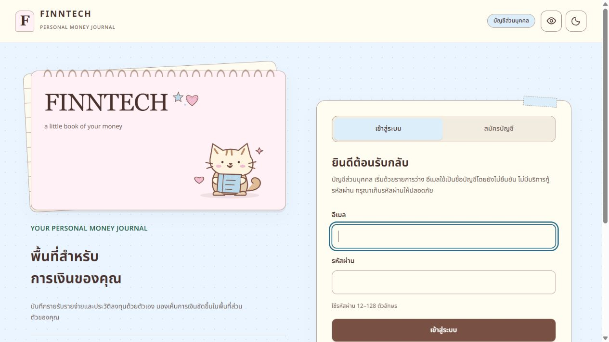
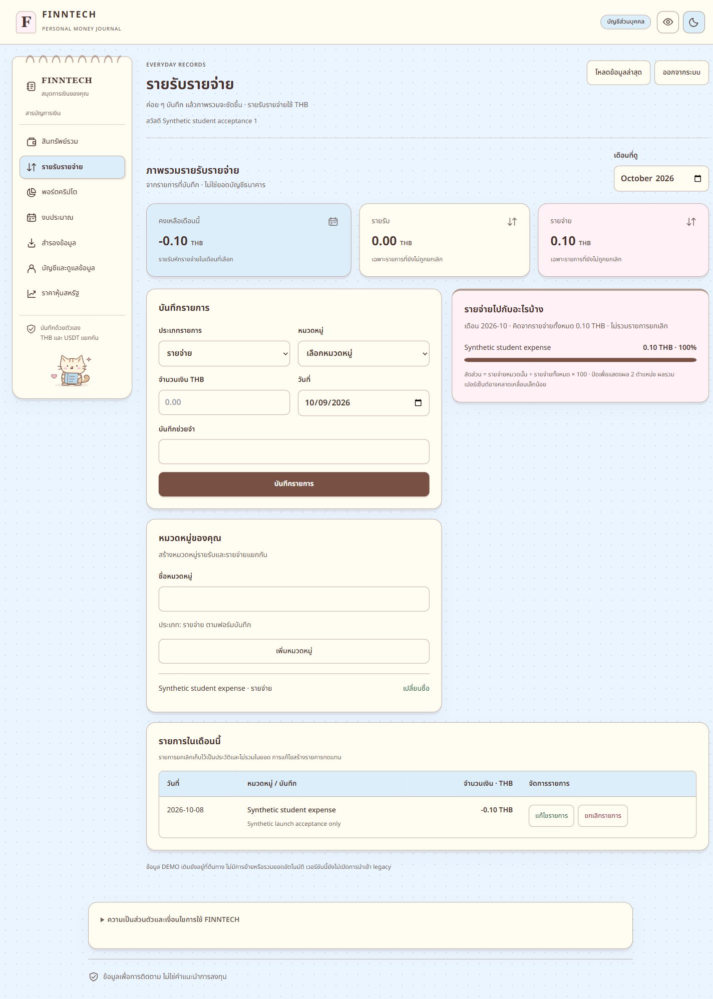
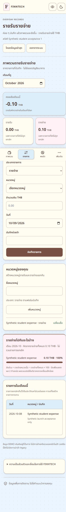
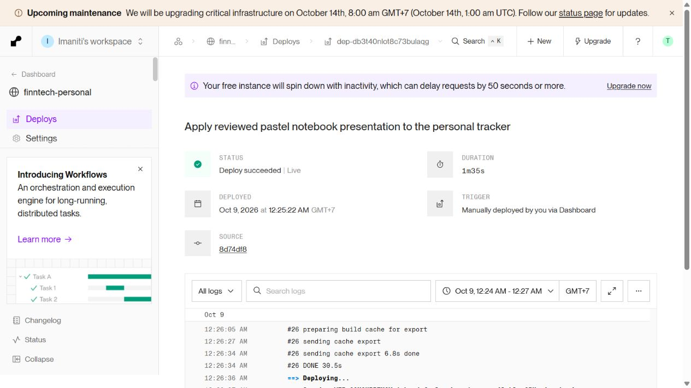

# FINNTECH notebook redesign — live deployment, 2026-10-09

Owner explicitly authorized publishing the reviewed redesign. Live real-use URL: **https://finntech-personal.onrender.com/**. Render reports **Deploy succeeded | Live**, duration **1m35s**. Deployment started 2026-10-09 00:25:22 Asia/Bangkok.

## Release identity and boundaries

- Render service: `finntech-personal`, `srv-db3pcll9fdbs73enrmg0`, existing Free Docker service.
- Deployment: `dep-db3t40nlot8c73bulaqg`.
- Repository/branch: `SABKUSRC69/finntech-beta`, `codex/student-real-use`.
- Commit: `8d74df8e3aa2b31310681edc59890b716216241b`; previous `74812cbd16cef6bf2835af88ab153c5d1d8ba642`.
- Release source manifest SHA-256: `c923893dc56a4c740e6e1c15655af6b16f081ff604f043f67c45832359e2ee22`.
- Exactly 13 frontend files changed: notices, two original SVG assets, App, AccountDeletion, journal.css, presentation, Account, Backup, FinanceHistory, ModalDialog, PageIntro and TrackerNavigation. See incremental release patch and published file list beside this report.
- All prior non-frontend runtime files were verified byte-identical before publishing. No API, schema, migration, dependency, environment, enrollment or ownership policy change. No migration/reset/deletion/import/financial write was performed.
- Published from the existing isolated release repository. The owner's working repository was not staged, committed, reset or pushed. Existing tracked and untracked work was preserved.
- No fixture script, fixture toolbar, sample-data injection, private env, credentials, backup or review screenshots entered the cloud build context. Only original local SVGs and the existing licensed local Thai font are used. No purchase, new paid service or redesign dependency.
- The separate `finntech-beta.onrender.com` DEMO service and its database were not updated. Real-use uses its existing separate personal database.

## Actual verification

| Check | Actual result | Exit |
|---|---|---:|
| `npm --workspace apps/web run build` | TypeScript and Vite build PASS, 60 modules | 0 |
| `npm --workspace apps/web run test` | 16 files, **104 tests PASS** | 0 |
| Root `git diff --check` | PASS; existing CRLF conversion warnings only | 0 |
| Release preparation integrity | 13 frontend files, 93 manifest files; non-frontend unchanged; fixture excluded | 0 |
| Release/bundle known-secret scan | 95 files scanned, zero known configured secrets found | 0 |
| Release staged diff check and isolated commit/push | 13 allowed paths only; push succeeded | 0 |
| Render Docker build | `npm ci`, full `tracker:build`, runtime closure 119 packages, image publication succeeded | Build step DONE, deployment Live |
| HTTPS acceptance script | `/api/ready` 200/ready, database OK, real mode/public registration unchanged, email-password mode, no DEMO/recovery enabled | 0 |
| HTTPS asset checks | Current JS/CSS 200, notebook styles present, both SVGs/font/OFL byte-identical to local assets | 0 |
| Anonymous API authorization | `/api/me` and `/api/backup` both 401 | 0 |
| Two-account persistence script | Existing synthetic accounts have distinct original owners and exact prior persisted categories/transactions/budgets/portfolios/trades/cash-account export arrays; expense remains Decimal string `0.1` | 0 |
| Logout/login acceptance | Logout denies account read; genuine email/password login resumes same owner/data | 0 |
| Live browser login and finance responsiveness | Each checked at 320/375/390/768/1024/1280/1440, light and dark: 28 cases, no document overflow | PASS |
| Live browser seven screens | Overview, finance, crypto, budget, backup, account, stocks at 1440/390, light/dark: 28 cases, correct headings/no overflow/no fixture banner | PASS |
| Live mobile More keyboard | Native dialog, Shift+Tab wraps to last item, Tab wraps to close button, Escape closes and restores More focus | PASS |
| Browser logout | Existing synthetic account logged out; public login left open with cleared input | PASS |

Full seven-command local redesign acceptance already passed on the unchanged implementation in the preceding review: root 408 tests, tracker 263 tests, both builds, tracker typecheck, package smoke and diff check. Those are historical results linked in [the local review](notebook-redesign-review-20261008.md), **not a claim that all seven commands were rerun during this deployment**. This deployment reran the focused frontend checks above and added actual HTTPS/persistence/browser checks.

Cloud built assets are `/assets/index-BAkPJK8q.js` and `/assets/index-teajGg4O.css`. Local root build hashes differ because its Tailwind scan context includes additional root files; live screen checks use the actual cloud artifacts.

## Evidence and limitations

Evidence folder: `notebook-deploy-evidence-20261009/`: release manifest, published file list, known-secret scan, HTTPS/persistence JSON, responsive/page/dialog JSON, release-only incremental patch and screenshots. Raw account credentials, cookies and exported records remain only in ignored private local files and are excluded from the report.

- **PASS:** genuine live browser login/navigation/logout, two-account owner/persisted data preservation, protected anonymous reads, real registration capability and theme/responsive/More smoke checks. Verification used only preexisting synthetic acceptance accounts; no owner financial records were inspected.
- **NOT TESTED in this deploy:** new public signup submission, new financial write/void, live restore/import, load/stress tests, physical touch devices, assistive technology, and new HTTP/WS expiration tests. Existing suites/local review cover relevant unchanged behavior; this is not full production/security certification.
- **Known unchanged limitations:** free hosting may sleep/no SLA; verification and password recovery remain unavailable in supported email-password mode; live stock provider is unconfigured and correctly displays unavailable/N/A. No fake provider/email functionality was enabled.
- Render's unchanged `npm ci` audit output reported **14 dependency vulnerabilities (2 moderate, 12 high)** and Prisma/OpenSSL detection warnings. Build and actual database acceptance passed. Dependency remediation/runtime exploitability were not assessed or changed in this visual deployment; do not infer an audit-clean release.
- Failed preparation attempt: integrity enumeration initially treated the isolated release's existing tracked `.gitignore` as an unexpected runtime file. Preparation stopped with exit 1 before publication; the check was corrected to verify it against release Git HEAD and final preparation passed. No unrelated file was added or modified.
- Browser evidence instrumentation initially checked HTML `.dark` instead of the existing theme button and explicit `[role=dialog]` instead of native `<dialog>`. Both measurements were corrected and rerun against the actual live UI; final JSON records both themes and native dialog containment correctly.

## Operational notes

If an already-open tab shows the previous design, refresh it to load the new hashed assets. Public signup remains available through **สมัครบัญชี**. DEMO access stays on the separate Beta website.

Rollback, if required, can use Render's existing previous successful deployment of `74812cb` without database rollback. No rollback was performed. No automatic deployment was enabled or new cloud settings changed.
