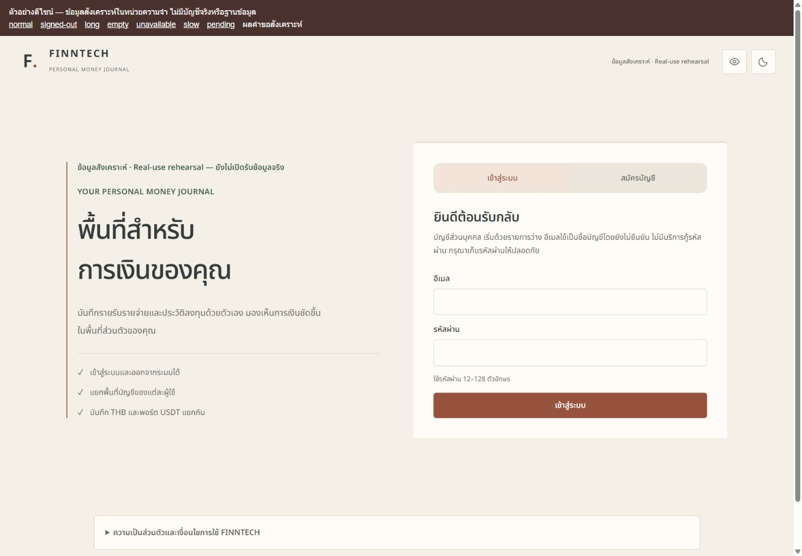
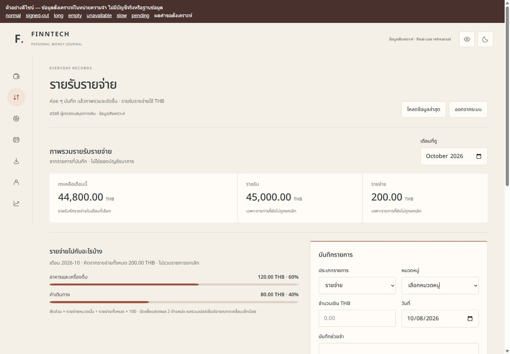
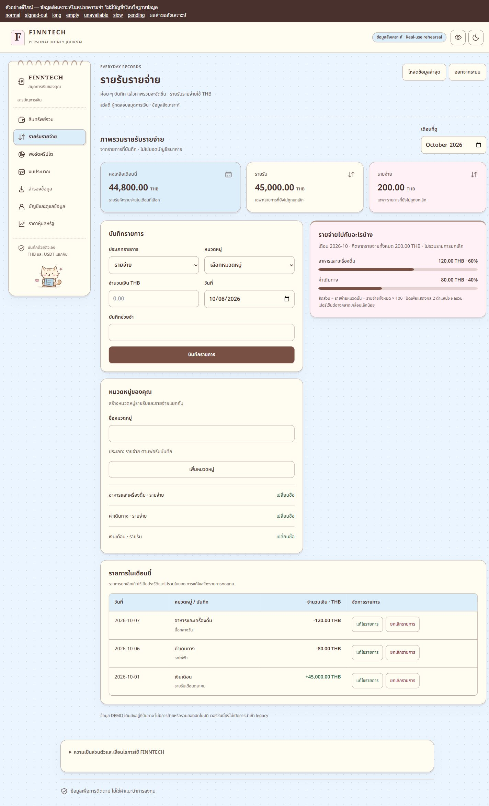
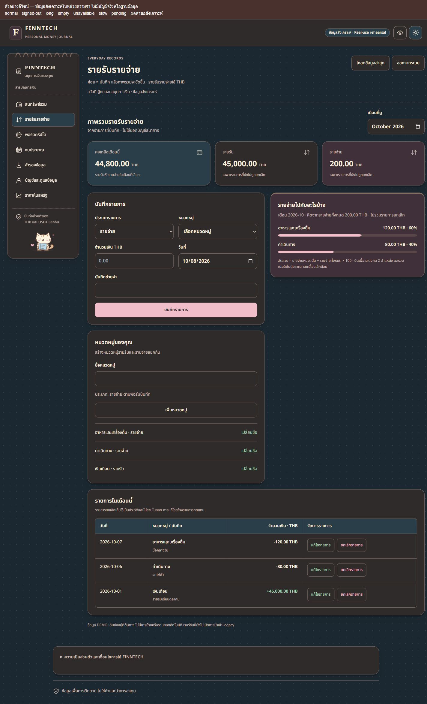
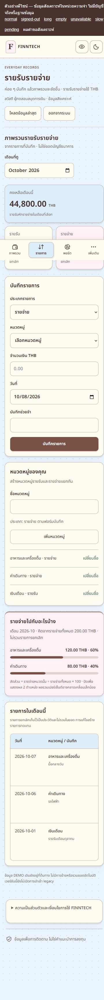
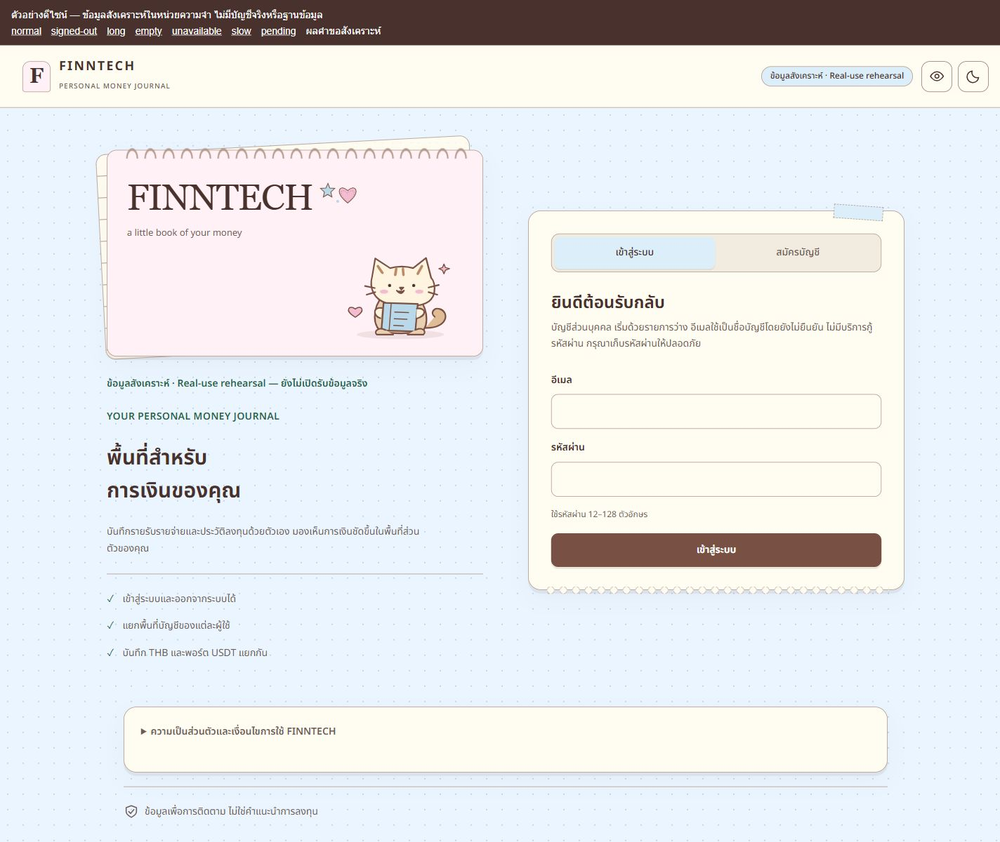
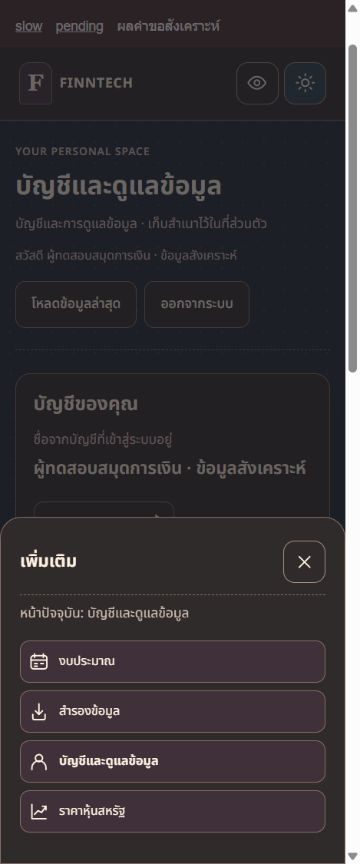

# FINNTECH notebook redesign — local review, 2026-10-08

Completed tracker frontend presentation only. No commit, push, deployment, cloud settings, real accounts or real databases were used. Public real-use and DEMO services remain unchanged. Starting snapshot: 518 tracked/untracked paths; incremental patch is against this task's snapshot, not Git HEAD. Unrelated owner work preserved.

## Design and reference

Rendered and visually inspected all 10 Canva PDF pages, with full-size inspection of 1, 2, 7 and 8. Pale blue dots, cream/pink paper, brown outlines, binding hints, layered auth paper, scalloped auth edging, star/heart stickers and an original small ledger cat replace the prior minimalist presentation. A 240px visible notebook sidebar carries Thai labels; mobile retains four destinations and the guarded More sheet. Forms and tables remain level and semantic; rotated layers are decorative only. Dark theme uses blue/brown canvas, warm dark paper and cream text. No portraits, names, slide rasters, charts or sample figures from the PDF were reused.

Shared CSS was replaced and organized into tokens, control/status styles, shell, paper layouts, auth and responsive rules; conflicting icon-only/sidebar and transparent-card overrides were removed. Auth/registration, assets, finance/history/category analysis, budgets, crypto/history, stocks, export/import, account/deletion and dialogs share these styles. Existing budget calculations and statuses are retained; no new goal, near-limit threshold or progress calculation was invented. Destructive account controls are last both visually and in DOM order.

## Open the local preview

The review fixture is explicitly labeled **ตัวอย่างดีไซน์ — ข้อมูลสังเคราะห์**. It serves the actual compiled tracker app with HTTP responses held in memory. It is not genuine auth or a persistent ledger. No account/financial state is stored in localStorage, no .env is loaded, and no database or market provider is contacted. The fixture is not imported by the production frontend or API.

From the repository after dependencies are installed:

```powershell
npm run tracker:build
node scripts/notebook-preview.mjs
```

Open http://127.0.0.1:4308/ . Stop this fixture with Ctrl+C in its terminal. The current review process is PID 22140; stop it only if its command line still identifies scripts/notebook-preview.mjs. Port can be overridden with NOTEBOOK_PREVIEW_PORT. Toolbar modes: normal, signed-out, long, empty, unavailable, slow, pending. Mode changes reset only in-memory fixture state. Fictional balances and intentionally stale reference prices are fixture responses, never production data. Missing/stale current valuations correctly stay N/A. Form submission here exercises UI requests/receipts, not actual persisted accounting or account creation.

For the actual configured tracker use the existing npm run tracker:dev workflow; no real-mode configuration or signup policy changes are required by this visual patch. Do not treat the preview health/auth responses as production acceptance.

## Final checks

| Command | Result | Exit |
|---|---|---:|
| npm test | 49 files, 408 tests PASS | 0 |
| npm run build | PASS | 0 |
| npm run tracker:typecheck | PASS | 0 |
| npm run tracker:test | 21 finance + 13 contracts + 125 API + 104 web = 263 PASS, dev smoke PASS | 0 |
| npm run tracker:build | PASS | 0 |
| node --no-strip-types scripts/tracker-package-smoke.mjs | PASS | 0 |
| git diff --check | PASS | 0 |

Final suite ran after all frontend changes. Logs and exact command times are in checks.json and check-0.txt through check-6.txt. Existing meaningful regression assertions were preserved without skips or reductions. No interaction/business policy was added; existing auth reconciliation, pending navigation, original-key retry, privacy, markets, ownership, ledger and recovery/deletion suites remain intact. 83 backend/shared/package files are byte-identical to the starting snapshot. No dependency changes. Final browser smoke was against the final compiled build.

## Browser evidence — PASS

- All seven authenticated screens at 320/375/768/1024/1440px in light/dark: 70 combinations (28 screenshot combinations plus 42 additional measured matrix entries). No document overflow or visible product buttons/inputs below 44px. Tables keep all columns/actions in their own labeled, keyboard-focusable horizontal scroll region. Auth/login and signup additionally inspected across all five widths in both themes; files in responsive.json.
- Long Thai labels/notes and Decimal strings: 30 additional finance/assets/selected-crypto combinations at all widths/themes; no page overflow or truncated amounts. Original numeric precision and units remain in text/inputs.
- 20 actual theme-token contrast pairs pass 4.5:1 for body/action text or 3:1 for focus/control boundaries. Noto local font loaded in browser; unchanged checksum/license verified. This is token contrast evidence, not a complete automated accessibility certification.
- More sheet: focus stays inside, Shift+Tab/Tab wraps, Escape dismisses, focus returns to More. Correction/void dialog also traps focus, Escape returns to its original row action; no cancellation was submitted.
- Simulated lost response: primary and secondary navigation and logout stayed disabled, More remained dismissible, retry produced two requests with identical payload and idempotency key; success released locks. retry.json contains only counts/booleans.
- Privacy hides quantities and amounts while preserving N/A, stale text and input 0.00000001. No presentation state is persisted as account data. Theme toggle operates in memory.
- Registration mismatch displayed its existing validation and sent zero requests; matching confirmation completed the existing UI with a synthetic session response. No real account created.
- Backup file chooser delivered a schema-valid synthetic JSON to the existing preview/consent UI; matching synthetic receipt cleared pending state. Actual DB restore/download persistence is outside this presentation fixture. Existing backup regression tests pass.
- Empty finance, slow-loading and failed-read states captured. Stock screen retained NOT_CONFIGURED and no invented prices/charts. Selected crypto kept stale market prices out of current P&L. All statuses are responses of the explicitly synthetic fixture.
- Final mobile last account checkbox/button measured above bottom nav; app has 100px plus safe-area bottom clearance. Account DOM order matches its visible destructive section at the end.

## Failed attempts / limits / NOT TESTED

The first sandbox preview could not be reached because of local socket restrictions; the approved loopback process was restarted. A temporary EADDRINUSE launch exited 1 until only our earlier preview process was stopped. The first new backup fixture exited 1 with a missing budget month; fixed the fixture, retained schema assertions, and the corrected runner started successfully. No application regression test failed. File chooser automation took approximately 2302 seconds to return; afterward browser preview and consent/receipt were actually observed. A contrast helper initially failed to parse shorthand #fff; parser corrected, final actual primary contrast 6.90:1. Some exact-label selectors differed between native AX and DOM roles; resolved using observed combobox/label controls, without bypassing guards.

Real DB writes, two-user cloud reacceptance, real backup restore, live recovery/verification mail, live DEMO entry, session expiration/WS revocation, device safe-area hardware and physical touch: NOT TESTED in this redesign task. Conditional recovery/DEMO remain server-controlled; shared styles apply and existing regression tests pass, but they are not enabled in this real-mode visual fixture. No provider credentials were added. Reduced-motion CSS disables transitions/animations; assistive-technology screen-reader and OS reduced-motion end-to-end audit: NOT TESTED. No new security/production-readiness claim from visual checks.

## Free assets and provenance

Noto Sans Thai remains local and unmodified under SIL OFL 1.1; public/fonts/OFL.txt retained in build. SHA256 5A1C559BB539583C8A1FD99D1C5B9491E5E14478C9CD2BD0970D5C3096CC9EF8. Original notebook-cat.svg, notebook-stickers.svg, CSS layers/dots/tape/binding and new notebook/close paths were authored for FINNTECH. No Canva-exported assets, Pro blocks, remote fonts, new library, paid template, external tracking or purchases. See apps/web/THIRD_PARTY_NOTICES.md.

## Screenshots

Before:




Final finance, desktop light/dark:




Final mobile and auth:





All 62 screenshots, including every requested primary screen/theme and stress/pending/keyboard states:

- [account-1440-dark.jpg](notebook-redesign-evidence-20261008/account-1440-dark.jpg)
- [account-1440-light.jpg](notebook-redesign-evidence-20261008/account-1440-light.jpg)
- [account-375-dark.jpg](notebook-redesign-evidence-20261008/account-375-dark.jpg)
- [account-375-light.jpg](notebook-redesign-evidence-20261008/account-375-light.jpg)
- [account-keyboard-bottom-375-light.jpg](notebook-redesign-evidence-20261008/account-keyboard-bottom-375-light.jpg)
- [assets-1440-dark.jpg](notebook-redesign-evidence-20261008/assets-1440-dark.jpg)
- [assets-1440-light.jpg](notebook-redesign-evidence-20261008/assets-1440-light.jpg)
- [assets-375-dark.jpg](notebook-redesign-evidence-20261008/assets-375-dark.jpg)
- [assets-375-light.jpg](notebook-redesign-evidence-20261008/assets-375-light.jpg)
- [auth-1440-dark.jpg](notebook-redesign-evidence-20261008/auth-1440-dark.jpg)
- [auth-1440-light.jpg](notebook-redesign-evidence-20261008/auth-1440-light.jpg)
- [auth-375-dark.jpg](notebook-redesign-evidence-20261008/auth-375-dark.jpg)
- [auth-375-light.jpg](notebook-redesign-evidence-20261008/auth-375-light.jpg)
- [backup-1440-dark.jpg](notebook-redesign-evidence-20261008/backup-1440-dark.jpg)
- [backup-1440-light.jpg](notebook-redesign-evidence-20261008/backup-1440-light.jpg)
- [backup-375-dark.jpg](notebook-redesign-evidence-20261008/backup-375-dark.jpg)
- [backup-375-light.jpg](notebook-redesign-evidence-20261008/backup-375-light.jpg)
- [backup-preview-375-light.jpg](notebook-redesign-evidence-20261008/backup-preview-375-light.jpg)
- [backup-receipt-375-light.jpg](notebook-redesign-evidence-20261008/backup-receipt-375-light.jpg)
- [before-auth-desktop.jpg](notebook-redesign-evidence-20261008/before-auth-desktop.jpg)
- [before-finance-desktop.jpg](notebook-redesign-evidence-20261008/before-finance-desktop.jpg)
- [before-finance-mobile.jpg](notebook-redesign-evidence-20261008/before-finance-mobile.jpg)
- [budget-1440-dark.jpg](notebook-redesign-evidence-20261008/budget-1440-dark.jpg)
- [budget-1440-light.jpg](notebook-redesign-evidence-20261008/budget-1440-light.jpg)
- [budget-375-dark.jpg](notebook-redesign-evidence-20261008/budget-375-dark.jpg)
- [budget-375-light.jpg](notebook-redesign-evidence-20261008/budget-375-light.jpg)
- [crypto-1440-dark.jpg](notebook-redesign-evidence-20261008/crypto-1440-dark.jpg)
- [crypto-1440-light.jpg](notebook-redesign-evidence-20261008/crypto-1440-light.jpg)
- [crypto-375-dark.jpg](notebook-redesign-evidence-20261008/crypto-375-dark.jpg)
- [crypto-375-light.jpg](notebook-redesign-evidence-20261008/crypto-375-light.jpg)
- [crypto-selected-1440-dark.jpg](notebook-redesign-evidence-20261008/crypto-selected-1440-dark.jpg)
- [crypto-selected-1440-light.jpg](notebook-redesign-evidence-20261008/crypto-selected-1440-light.jpg)
- [crypto-selected-375-dark.jpg](notebook-redesign-evidence-20261008/crypto-selected-375-dark.jpg)
- [crypto-selected-375-light.jpg](notebook-redesign-evidence-20261008/crypto-selected-375-light.jpg)
- [empty-finance-375-light.jpg](notebook-redesign-evidence-20261008/empty-finance-375-light.jpg)
- [error-finance-375-light.jpg](notebook-redesign-evidence-20261008/error-finance-375-light.jpg)
- [final-finance-desktop-dark.jpg](notebook-redesign-evidence-20261008/final-finance-desktop-dark.jpg)
- [final-finance-desktop-light.jpg](notebook-redesign-evidence-20261008/final-finance-desktop-light.jpg)
- [final-finance-mobile-dark.jpg](notebook-redesign-evidence-20261008/final-finance-mobile-dark.jpg)
- [final-finance-mobile-light.jpg](notebook-redesign-evidence-20261008/final-finance-mobile-light.jpg)
- [finance-1440-dark.jpg](notebook-redesign-evidence-20261008/finance-1440-dark.jpg)
- [finance-1440-light.jpg](notebook-redesign-evidence-20261008/finance-1440-light.jpg)
- [finance-375-dark.jpg](notebook-redesign-evidence-20261008/finance-375-dark.jpg)
- [finance-375-light.jpg](notebook-redesign-evidence-20261008/finance-375-light.jpg)
- [loading-finance-375-light.jpg](notebook-redesign-evidence-20261008/loading-finance-375-light.jpg)
- [long-crypto-320-dark.jpg](notebook-redesign-evidence-20261008/long-crypto-320-dark.jpg)
- [more-375-dark.jpg](notebook-redesign-evidence-20261008/more-375-dark.jpg)
- [more-375-light.jpg](notebook-redesign-evidence-20261008/more-375-light.jpg)
- [pending-finance-375-light.jpg](notebook-redesign-evidence-20261008/pending-finance-375-light.jpg)
- [pending-more-375-light.jpg](notebook-redesign-evidence-20261008/pending-more-375-light.jpg)
- [privacy-crypto-320-dark.jpg](notebook-redesign-evidence-20261008/privacy-crypto-320-dark.jpg)
- [review-desktop-light.jpg](notebook-redesign-evidence-20261008/review-desktop-light.jpg)
- [signup-1440-dark.jpg](notebook-redesign-evidence-20261008/signup-1440-dark.jpg)
- [signup-1440-light.jpg](notebook-redesign-evidence-20261008/signup-1440-light.jpg)
- [signup-375-dark.jpg](notebook-redesign-evidence-20261008/signup-375-dark.jpg)
- [signup-375-light.jpg](notebook-redesign-evidence-20261008/signup-375-light.jpg)
- [signup-validation-375-dark.jpg](notebook-redesign-evidence-20261008/signup-validation-375-dark.jpg)
- [stocks-1440-dark.jpg](notebook-redesign-evidence-20261008/stocks-1440-dark.jpg)
- [stocks-1440-light.jpg](notebook-redesign-evidence-20261008/stocks-1440-light.jpg)
- [stocks-375-dark.jpg](notebook-redesign-evidence-20261008/stocks-375-dark.jpg)
- [stocks-375-light.jpg](notebook-redesign-evidence-20261008/stocks-375-light.jpg)
- [void-dialog-375-light.jpg](notebook-redesign-evidence-20261008/void-dialog-375-light.jpg)

Stop here for the owner's local visual review. Public deployment remains unchanged.

## Incremental delivery

Actual changed-file list: [changed-files.json](notebook-redesign-evidence-20261008/changed-files.json). Patch: [notebook-redesign-incremental-20261008.patch](notebook-redesign-incremental-20261008.patch), with a separate SHA256 file. Includes the original local SVGs and all evidence. Reverse applicability check against the current working tree passed, exit 0. Product/source scope is 14 files (frontend/art/notices plus the separate synthetic fixture); remaining changed paths are the review report, screenshots, logs and evidence. The prior before-design fixture process was stopped; only the new review preview is retained for local inspection.
