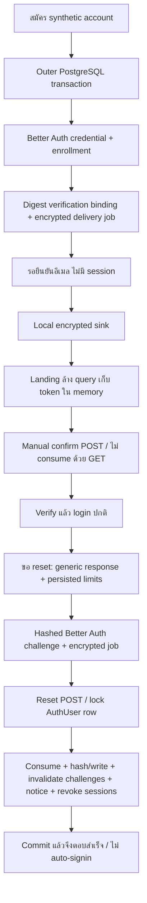

# FINNTECH ช่วง 3A — ส่ง independent review

วันที่ 2026-10-07 Asia/Bangkok. ทำ recovery/verification ขั้นต่ำบน Better Auth **1.7.7** เดิม และ PostgreSQL สังเคราะห์แยกเท่านั้น พัก redesign ไม่มี dependencies ใหม่ ไม่ commit/push/deploy และไม่เริ่ม 3B

**Default recovery OFF**. ไม่แก้ `apps/api/.env` ไม่เปิด requireEmailVerification ให้ owner และไม่ใช้ฐาน/session/credentials ของ owner ใน harness งาน uncommitted/untracked เดิมเก็บไว้ Patch นี้เทียบ snapshot ก่อนเริ่มช่วงนี้ ไม่เทียบ HEAD ซึ่งยังไม่มีไฟล์ tracker จำนวนมาก

## Integration และ flow

อ่าน installed source ของ password, email-verification, sign-up, internal adapter, verification-token-storage, database hooks และ Prisma adapter จริงก่อนเลือก integration ไม่อาศัยชื่อ option จาก tutorial และไม่เปลี่ยน password store/algorithm

Better Auth ไม่รับประกัน transaction ครอบทั้ง endpoint จาก `transaction:true` เพียงอย่างเดียว จึงสร้าง runtime ภายใน **outer Prisma transaction** ใช้ adapter `transaction:false` กับ transaction client และ serialize subject ด้วย AuthUser `FOR UPDATE` ก่อน consume ไม่จับ ledger lock การ consume/password/hook/revocation/outbox อยู่ใน transaction เดียว Fault ที่ทดสอบ rollback ทุกส่วนได้ จึงไม่ได้ใช้ pending security barrier แทน transaction

Verification ใช้ signed JWT ของ Better Auth ร่วมกับ digest binding ใช้ได้ครั้งเดียว Reset ใช้ hashed identifier ของ Better Auth เอง Existing unverified synthetic account ต้องพิสูจน์ password ปัจจุบันก่อน enrollment; owner mapping `VERIFIED` ไม่ใช่ `emailVerified` รับ client emailVerified เพื่อ promote ไม่ได้ ไม่มี auto-session หลัง signup/verify/reset

Config เปิดได้เฉพาะ non-production + `synthetic-3a` + explicit `synthetic-only` + exact DB/role/port/origin + server-only AES key และ sink directory ระบุ 900s reset / 24h verification เป็นค่าทดลอง **ไม่ใช่ policy อนุมัติสำหรับข้อมูลจริง** Health capability มาจาก integration จริง Frontend ไม่ใช้ VITE secret

| Route | Feature OFF | Synthetic ON |
|---|---|---|
| Auth signup/signin/signout/get-session/ok เดิม | คง behavior เดิม | signup รอยืนยัน; session/access gated |
| POST `/api/auth/request-password-reset` | 404 | Generic, เฉพาะ enrolled/verified/unblocked สร้าง reset job |
| POST `/api/auth/reset-password` | 404 | Policy 12–128 + confirmation, atomic reset |
| POST `/api/auth/confirm-email` | 404 | JWT + digest + expiry + subject gate |
| POST `/api/auth/begin-verification` | 404 | Password proof สำหรับ unverified synthetic account |
| GET library verify/reset/scanner และ send-verification-email | ไม่เพิ่ม allowlist | ไม่มี consume GET; ไม่เปิด library bypass |
| GET `/api/auth-capabilities` | false/false | true/true ไม่มี token |
| `/account/reset`, `/account/verify` | ไม่มี recovery controls | Memory token, query cleared, no-store/no-referrer/CSP |

ไม่มี wildcard เปิด Auth routes ทั้งหมด ไม่ใช้ Host/forwarded headers/client callback สร้าง origin ของ link ทุก mutable route ตรวจ exact Origin Recovery reject spoofed Host/forwarding/external callback

## Isolation / migration / lifecycle

Target ใหม่ `finntech-recovery-3a-20261007`: role `recovery_fixture`, DB `finntech_recovery_3a_20261007`, volume `finntech-recovery-3a-20261007_recovery_3a_20261007_pgdata`, PG `127.0.0.1:5441`, API/web `127.0.0.1:4197` ทุกอีเมลที่ส่งเป็น `@example.invalid` รหัสผ่านสุ่มใน memory ไม่อ่านข้อมูล owner

เพิ่ม forward migration `20261007000000_isolated_recovery` เฉพาะ enrollment / encrypted outbox / HMAC rate buckets ไม่แก้ migrations เก่า Apply 7 migrations บน target ว่างที่ตรวจ database/role/tables ก่อนแล้วเท่านั้น Repeat tests append บัญชีใหม่ ไม่ reset/drop/truncate/delete DB หรือ volume Re-run prepare บนฐานที่มีข้อมูลถูกปฏิเสธ exit **2** ตาม guard โดยไม่ migrate

Docker daemon เดิมไม่พร้อมตอนเริ่ม ใช้ Docker Desktop ที่ติดตั้งแล้วและ image postgres:16-alpine ที่มีอยู่ ไม่ pull/install หลังตรวจ health และ browser ได้หยุดเฉพาะ API ที่ตรวจ ownership และ compose service ของช่วงนี้แล้ว ไม่มี listener 4197/5441 และ volume ยังอยู่ ดู `lifecycle.json` ไม่หยุด services/projects เก่าหรือ Docker daemon

## Delivery และ consistency evidence

Server-only sink ไม่มี public mailbox/token-read endpoint Payload ขั้นต่ำ AES-256-GCM, fingerprint HMAC, verification identifier hashed directory ส่วนตัว `.phase3a-20261007.local` จำกัด Windows ACL ให้ Admin/SYSTEM เก็บ env/key และ encrypted messages แยกจากหลักฐาน

Durable job locked `FOR UPDATE SKIP LOCKED`, retry 2/4/8 seconds สูงสุด **4 attempts** และใช้ absolute challenge expiry เดิม ไม่มี fire-and-forget callback หรือขยาย token expiry Sink atomic-link encrypted file และ duplicate ต้อง bytes ตรงกัน หลังส่ง clear DB envelope; FAILED ต้องตรวจ reason code/key/disk โดย operator ไม่ bypass auth FAILED ciphertext retention/key rotation/cleanup policy รอ 3B

Faults ที่ยิงจริง: after-consume, after-hash, after-password-update, before-session-revoke, after-reset-hook, after-session-revoke, before-delivery-enqueue การ fail ไม่คืน success เท็จ credential/challenge/session rollback ใน PostgreSQL Notice/old challenges อยู่ใน transactionเดียว Process restart จริงกู้ queued delivery หลัง acknowledgement สูญหาย ด้วย ID/encrypted bytes/expiry เดิม

หลัง reset วัด WS market/stocks ปิด **5008/5008 ms** รวม reset/DB latency; PostgreSQL stop จริงวัด **3808/3809 ms** รวมเวลาหยุด DB ไม่อ้างปิดทันทีหรือ SLA ≤5s HTTP ใช้ old session ไม่ได้ และ DB outage ตอบ 503

Response-loss test ส่งผ่าน HTTP จริง หน่วงจบ response body หลัง DB commit แล้ว abort client: password ใหม่ยัง login ได้ session เดิมถูก revoke token replay ไม่ได้ และไม่มี auto-session UI test ไม่ resubmit เมื่อ unknown/503 และล้าง password/token ใช้ login ปกติ/ขอลิงก์ใหม่ ไม่ตีความ timeout เป็น rollback

Digest comparison ของ finance categories/transactions, cash, crypto trades, owner identity, audit และ idempotency ไม่เปลี่ยน Recovery ไม่แตะ financial payload/key มี precision fixture THB `123456789012345678.99` และ cash `99.25` ส่วน USDT/USD arithmetic ใช้ finance regression tests เดิม ไม่อ้างว่าได้ทดสอบ production portfolio

## A01–A12

PASS หมายถึงเฉพาะหลักฐาน/target ที่ระบุ ไม่ใช่ production readiness

| Scenario | ผล | หลักฐาน / ขอบเขต |
|---|---|---|
| A01 | PASS | HTTP status/body generic เหมือนกัน n=5 ต่อกลุ่ม; verified 521–526ms, unverified 512–553ms, unknown 513–521ms; ส่งเฉพาะ verified ไม่ใช่ proof ว่าไม่มี timing side channel ทุก workload |
| A02 | PASS | JWT tamper/DB expiry/library JWT expiry/replay/wrong logged-in subject; legacy password proof; no session; owner UUID เดิม |
| A03 | PASS | Invalid/expired/reused/wrong-session-subject reset; race token เดียวสำเร็จหนึ่งครั้ง; challenges เก่า invalidated |
| A04 | PASS | GET ไม่ mutate; 12–128/confirmation; old password ไม่ผ่านหลัง commit |
| A05 | PASS | สอง device sessions revoke, HTTP ปฏิเสธ, WS market/stocks ปิดจริง; owner/ledger digest เดิม; process restart + DB outage |
| A06 | PASS ใน injected faults | 6 จุดใน reset + enqueue fault rollback; restart หลัง rollback/queued job พิสูจน์จริง; kill process ระหว่าง transaction ที่กำลังทำงาน NOT TESTED |
| A07 | PASS | Actual HTTP body response loss after commit + no token replay/new automatic session; UI unknown ไม่มี auto-resubmit |
| A08 | PASS sink / NOT TESTED provider | Restart/ack-loss/duplicate/retry 4 ครั้ง/expiry/enqueue fault; provider/รับอีเมลจริงยังไม่มี |
| A09 | PASS loopback | Origin/callback/Host/forwarded spoof; account cap 20/minute; 61 distinct accounts คนละ 1 hit ใช้ peer bucket 60/minute ร่วมกันสอง OS processes (60 generic/1 limited); proxy production NOT TESTED |
| A10 | PASS บางส่วน / NOT TESTED บางส่วน | Query cleared, token ไม่ render, encrypted sink/DB digest, no-store/no-referrer/CSP, server key ไม่เข้า web; unit storage assertion; browser storage/network/proxy audit เต็มรูปแบบและ browser reset ด้วย tokenจริง NOT TESTED |
| A11 | PASS blocked gate / NOT TESTED deletion/restore | Explicit blocked enrollment: /me, finance, get-session, recovery และ subject gate ปฏิเสธ ไม่มี mapping เปลี่ยน; ไม่ได้ implement/test deletion-pending workflow, deleted user resurrection หรือ restore tombstones |
| A12 | PASS default-off / NOT TESTED rolloutจริง | Default signup/access เดิม + recovery routes/UI ปิด; ไม่มี auto-promote fixtures/DEMO, email change/link/admin/delete ยังไม่เปิด; owner rollout ยังไม่ทำ |

## Checks รอบสุดท้าย

| Command | ผลจริง | Exit |
|---|---|---:|
| `npm test` | 37 files, **322 pass**, 0 fail | 0 |
| `npm run build` | legacy build PASS | 0 |
| `npm run tracker:typecheck` | PASS; API typecheck หลังเพิ่ม harness รอบสุดท้าย PASS อีกครั้ง | 0 |
| `npm run tracker:test` | **193 pass** = finance21 + contracts13 + API85 + web74; dev smoke ผ่านและคืน port4175 | 0 |
| `npm run tracker:build` | shared/API/web PASS | 0 |
| `node --no-strip-types scripts/tracker-package-smoke.mjs` | compiled import/Decimal/ledger smoke PASS | 0 |
| `npm run tracker:db:validate` | Prisma schema valid | 0 |
| `node --no-strip-types --import tsx --env-file=.phase3a-20261007.local/runtime.env --test apps/api/db-test/recovery.integration.ts` | **14 pass**, 0 fail/skip | 0 |
| คำสั่งเดียวกันกับ `recovery-rate.integration.ts` | **1 pass**, 0 fail/skip, two actual processes | 0 |
| guarded prepare ซ้ำบน nonempty target | REFUSED ตามที่คาด ไม่มี mutation | 2 |
| `git diff --check` | PASS (tracked owner working tree) | 0 |
| `git -c core.autocrlf=false diff --check` (extra diagnostic) | FAIL: CRLF ถูกมองเป็น trailing whitespace ที่ PriceAlertModal.jsx:201 / tradingData.js:130 ซึ่งอยู่นอก patch ช่วงนี้ ไม่แก้ไฟล์เดิมเพื่อกลบผล | 1 |
| incremental patch reverse/whitespace check | Reverse apply check PASS; added trailing whitespace 0; รวม binary screenshots | 0 |

Final results/logs แยกจาก attempts ใน `phase3a-evidence-20261007/` Raw private env/mailbox ไม่รวมใน patch รายการ dependency ใหม่ **ไม่มี**

ตรวจ generated auth secret/outbox key/DB password เทียบหลักฐานที่เผยแพร่ภายในเครื่อง พบ matches **0**; private env/mailbox ไม่อยู่ใน manifest นี่ไม่ใช่การรับรอง full secret audit ของ repository เดิม

Attempts: typecheck แรก exit2 เพราะ exactOptional/unknown test types แก้แล้ว; PG attempt1 6 pass/5 fail exit1 เพราะ harness ชน Better Auth signin rate limit เดิมและ burst ข้าม minute bucket ไม่ได้ลด rate policy; attempts2/3/4 ผ่าน 11/13/13 tests. หลังเพิ่ม response-loss proof attempt5 13/14 exit1 (ephemeral Host ไม่ตรง guard), attempt6 12/14 exit1 (fetch ได้ headers ก่อน bodyจบ และ notice ค้างทำให้เลือกคนละ delivery job) แก้เฉพาะ harness ให้ exact origin, abort complete response และ drain pending jobsตาม workerปกติ ไม่มีการลบ fixtures/ลด assertion ผลสุดท้าย 14/14 + rate1/1

## Browser evidence และสิ่งที่ยังไม่ได้ตรวจ

Login/forgot/reset/verify 4 screens × widths320/390/768/1280/1440 × light/dark = **40 final cases** ไม่มี page overflow, theme ตรง requested และ query cleared เก็บ 16 screenshots ที่390/1440 + existing password-proof screenshotหนึ่ง Keyboard Enter เปิด/กลับ form, Tab จาก emailไปปุ่ม submit ผ่าน Console warn/error ที่เก็บ =0 ดู matrix/keyboard JSON

ตัววัดรอบแรกใช้ html class แทน `data-theme` จึงไม่นำมาอ้าง dark coverage ตรวจใหม่ครบ 40 หลังตั้ง theme จริงทุก navigation เครื่องมือ readonly DOM ไม่เปิด localStorage ใน browser scope จึงไม่อ้าง browser storage audit; storage มี unit assertion แยก

Browser credential entry/reset NOT TESTED: พรอมป์ F และนโยบาย computer-use กำหนด “Changing a password or other authentication credential: Ask the user to take over before any new credential is entered”. ไม่กรอกรหัสใหม่หรือ consume real link ผ่าน browser ใช้ backend synthetic harness พิสูจน์ส่วนเปลี่ยน credential แทน ไม่มีการขอให้ owner ส่งรหัส/secret

ยัง NOT TESTED: real provider/delivery, authenticated Account browser ด้วย sessionจริง, production proxy/logging/rate topology, crash ระหว่าง transaction, key-loss/rotation, real deletion/restore tombstones, long-duration/load และ owner rollout ไม่ทำ backup/FX/scheduler/retention/deletion redesign ในช่วงนี้

## ไฟล์และส่งต่อ

Incremental patch รวม 12 existing files ที่ snapshot ก่อนเริ่ม + new recovery service/delivery/migration/config+UI tests/สอง PG harnesses/target guard+prepare/compose/runbook+env examples/report/evidence. รายการ exact paths ใน `changed-files.json` และ patch รวม screenshots binary ไม่รวม private env/messages หรือ changes เดิมของเจ้าของ

แก้เฉพาะ baseline wording ใน phase2 report: mobile เดิม 6 รายการ → 4+More คง matrix70 ก่อน CSS delta + finalsheet4 เดิม ไม่อ้าง 70 บน final revision

3B ต้องให้ owner เลือกพื้นที่ข้อมูลจริงแยก/ช่องทางกู้การเข้าถึงหรือ deliveryจริง, อนุมัติ lifetimes/rollout, secrets/outbox key custody/rotation, backup storage/restore target และ proxy/rate/monitoring policy อ่าน runbook และ planning-only env example ได้ แต่ยังไม่สร้าง/activateพื้นที่จริง

**หยุดรอ independent review ของ 3A. ฟีเจอร์ยัง OFF สำหรับ owner ไม่ deploy และไม่เริ่ม 3B อัตโนมัติ**
