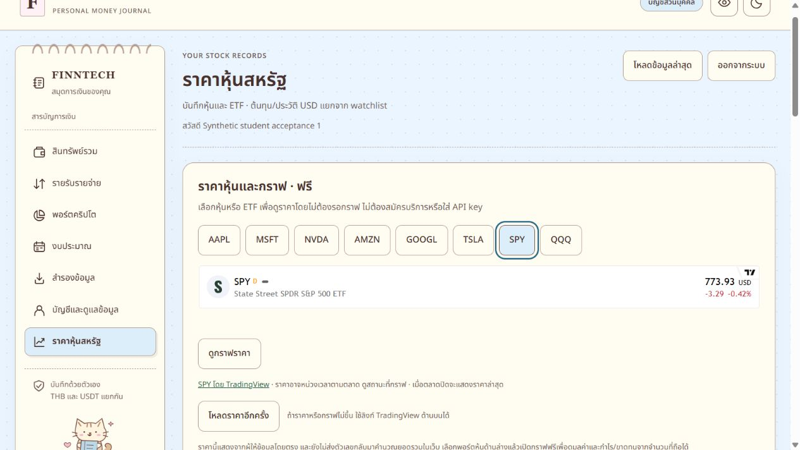
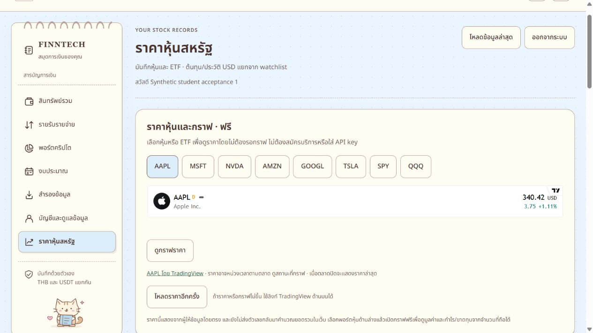
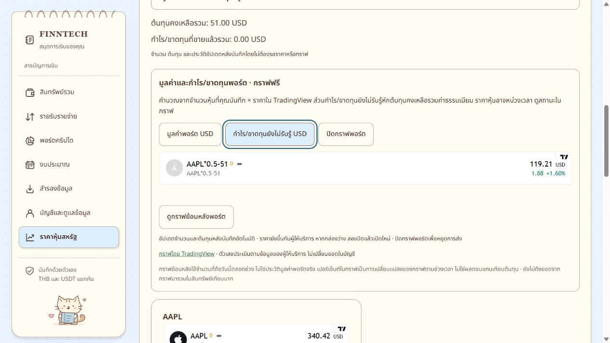
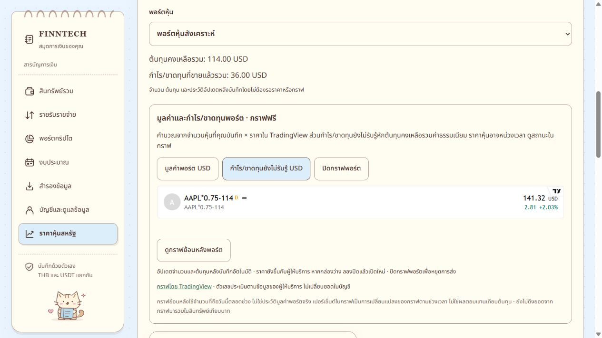
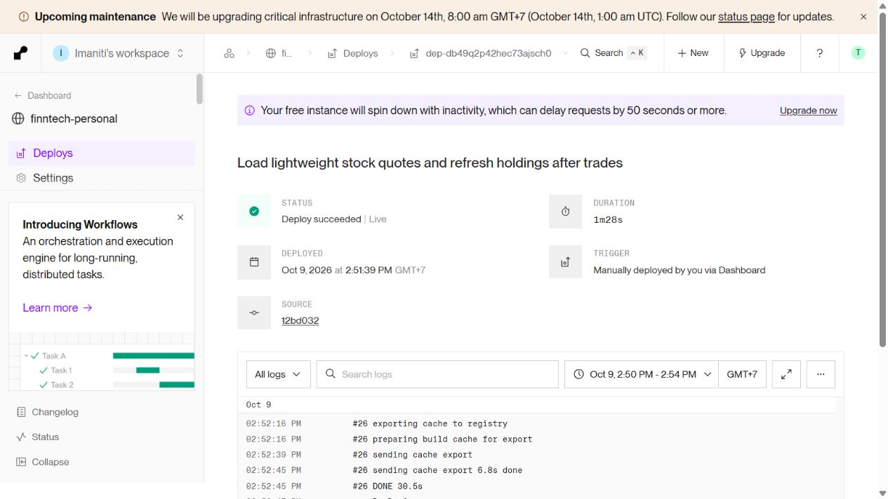

# หุ้น/ETF: โหลดราคาและอัปเดตหลังซื้อขาย — 9 ตุลาคม 2026

Deploy แล้วที่ [FINNTECH Personal](https://finntech-personal.onrender.com/) บน Render Free เดิม
commit `12bd0320fdd6f299669b863ed6ebbb467990a41f`, branch `codex/student-real-use`
deployment `dep-db49q2p42hec73ajsch0` แสดง **Deploy succeeded | Live** เวลา 14:53 น. Asia/Bangkok
ไม่มีการซื้อแพ็กเกจ เปลี่ยน hosting ตั้ง keepalive หรือเพิ่ม API key

## ปัญหาและผลแก้

- กราฟใหญ่โหลดทันทีทำให้รอนาน: ใช้ [TradingView Single Ticker](https://www.tradingview.com/widget-docs/widgets/tickers/single-ticker/) สูง 101 px แสดงราคาก่อน กราฟใหญ่เปิดด้วยปุ่มเท่านั้น
- การยินยอมประเมินพอร์ตเดิมผูกกับสูตรจำนวน/ต้นทุน พอบันทึกซื้อขายสูตรเปลี่ยนแล้วกล่องหาย: เปลี่ยนเป็นการยินยอมให้ส่งจำนวน/ต้นทุนที่อัปเดตขณะเปิดพอร์ตนั้น พร้อมข้อความชัดเจน ปิดหรือเปลี่ยนพอร์ตเพื่อหยุด และไม่บันทึกการยินยอมข้าม session
- ปุ่มโหลดข้อมูลล่าสุดเดิมไม่รีโหลดส่วนหุ้น: ตอนนี้โหลด holdings, ประวัติ, native market และกล่องราคาหุ้นด้วย โดยรักษาพอร์ตที่เลือก
- เลือกพอร์ตแรกหลังโหลดและพอร์ตใหม่หลังสร้าง แสดงจำนวน ต้นทุนคงเหลือ และกำไร/ขาดทุนที่ขายแล้วจาก ledger ได้ทันที โดยไม่ต้องรอผู้ให้บริการราคา

ราคาสาธารณะส่งเฉพาะสัญลักษณ์หุ้น ส่วนการประเมินพอร์ตส่งสัญลักษณ์ จำนวน และต้นทุนรวมเฉพาะหลังยินยอม ไม่ส่งบัญชี session หรือประวัติรายการให้ TradingView ซ่อนยอดเงินถอด iframe ประเมินพอร์ตออก
ไม่มีการแก้ API, schema, migration, dependencies หรือ credentials ใน release นี้

## ผลตรวจ

| การตรวจ | ผล |
| --- | --- |
| Root suite | 437 tests / 57 files ผ่าน |
| Web suite | 122 tests / 21 files ผ่าน |
| TypeScript และ tracker build ใน isolated release checkout | ผ่าน |
| ตรวจ secrets ใน runtime 8 ไฟล์และ assets 2 ไฟล์ | ไม่พบ secrets ที่ตั้งไว้ |
| Runtime diff whitespace check | ผ่าน |
| Production readiness | HTTP 200 |
| Production assets เทียบ build ที่ทดสอบ | JS/CSS SHA256 ตรงกัน |
| Production ข้อมูลบัญชีทดสอบ 2 บัญชี | hash และจำนวนรายการก่อน/หลังตรงกัน |

ทดสอบ browser กับ PostgreSQL **ในเครื่อง** และบัญชีสังเคราะห์เดิม โดยบันทึกผ่านฟอร์มจริง:

| ขั้นตอน | จำนวน AAPL | ต้นทุนคงเหลือ USD | กำไรที่ขายแล้ว USD |
| --- | ---: | ---: | ---: |
| ก่อนทดสอบ | 0.5 | 51 | 0 |
| ซื้อเพิ่ม 0.5 @ 200, fee 1 | 1 | 152 | 0 |
| ขาย 0.25 @ 300, fee 1 | 0.75 | 114 | 36 |

ทั้งสองครั้งแสดงบันทึกสำเร็จและประวัติใหม่ สูตรที่เปิดไว้เปลี่ยนอัตโนมัติเป็น `NASDAQ:AAPL*0.75-114` ไม่ต้องกดยินยอมซ้ำ ภาพหลังขายแสดงกำไรยังไม่รับรู้ 141.32 USD ตามราคาผู้ให้บริการในขณะตรวจ
ทดสอบเปลี่ยนพอร์ต การยินยอม ซ่อนยอดเงิน และ callback หลังสร้างพอร์ตด้วย tests เพิ่มเติม

Production ตรวจแบบอ่านอย่างเดียวด้วยบัญชีสังเคราะห์ที่ผู้ใช้อนุญาต ไม่มีการสร้าง/ซื้อ/ขาย/ยกเลิกรายการบน production
ตรวจภาพจริง: AAPL 340.42 USD, SPY 773.93 USD และสูตรพอร์ตเดิม `NASDAQ:AAPL*0.5-51` แสดง 119.21 USD หลังปุ่มโหลดข้อมูลล่าสุด โดยกราฟใหญ่ยังปิดอยู่ ตัวเลขนี้เป็นหลักฐาน ณ เวลาตรวจ ไม่ใช่ราคาปัจจุบันที่รับประกัน

| Asset | SHA256 |
| --- | --- |
| index-wao37DXB.js | d1f19b30cea7f65959d3b559425cd1f062ec524cf5eb9b1a403ac3f803663986 |
| index-DHSNb3oq.css | baf5ce76f6cee73a5e498aa11a93488be344da54011dea79bc65e60c2caf7e40 |

Production CSP คง `script-src 'self'`, `style-src 'self'`, `frame-src https://s.tradingview.com` โดยไม่เพิ่ม unsafe-inline
เผยแพร่เฉพาะ 8 runtime files จาก clean release checkout ไม่ commit/stage งานอื่นใน working repository

## ข้อจำกัดและคำถามเรื่องเว็บพัก

ราคายังขึ้นกับเครือข่าย/ผู้ให้บริการและอาจหน่วงเวลา เลือกได้ 8 ตัว: AAPL, MSFT, NVDA, AMZN, GOOGL, TSLA, SPY, QQQ
Alpaca native stock API ยัง NOT_CONFIGURED เพราะไม่มี key ราคาจาก widget ยังไม่ส่งกลับมารวมสินทรัพย์ THB ในระบบ
กราฟย้อนหลังใช้จำนวนที่ถือวันนี้ ไม่ใช่ประวัติมูลค่าพอร์ตจริง และเปอร์เซ็นต์ใน widget ไม่ใช่ผลตอบแทนเทียบต้นทุน
ในการตรวจ production รอบนี้ crypto API คืน UNAVAILABLE ทั้ง 7 เหรียญ การแก้และการยืนยันครั้งนี้ครอบคลุมหุ้น/ETF ตามคำชี้แจงล่าสุดของผู้ใช้ ไม่ได้อ้างว่า crypto พร้อม

[เอกสาร Render Free](https://render.com/docs/free) ระบุว่า Free web service พักหลังไม่มีคำขอเข้า 15 นาที และเริ่มใหม่ใช้ประมาณหนึ่งนาที การใช้ service compute แบบเสียเงินยกเลิกข้อจำกัดพักเมื่อ idle ได้ รอบนี้คง Free ตามคำขอ
ทางเลือกสำหรับงานต่อไปคือแยก frontend เป็น [Render Static Site](https://render.com/docs/static-sites) ฟรีที่เสิร์ฟผ่าน CDN เพื่อเปิดหน้าได้เร็วขึ้น แต่ backend ฟรีสำหรับอ่าน/บันทึกยังมี cold start อยู่ ข้อนี้เป็นข้อเสนอเชิงสถาปัตยกรรม ไม่ได้ย้ายระบบในรอบนี้

## หลักฐาน

