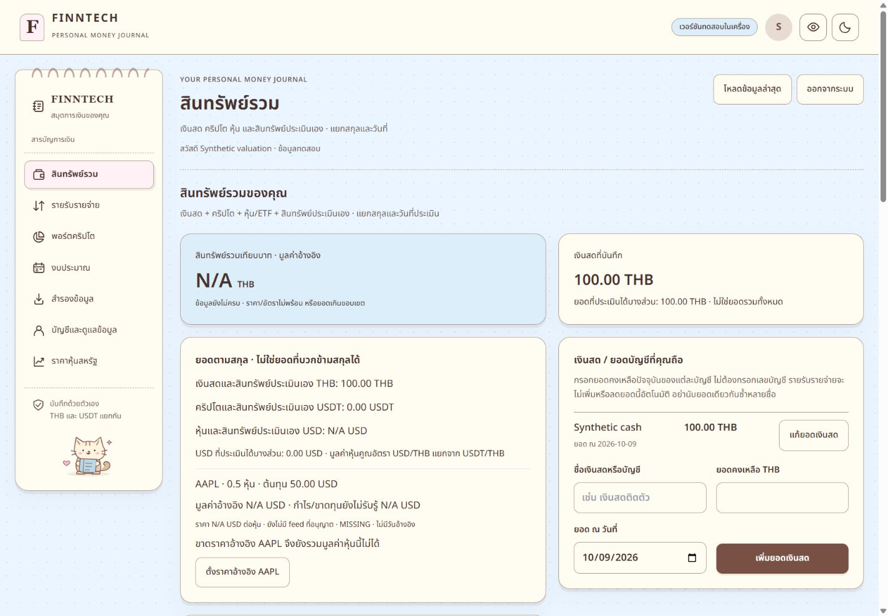

# Stock valuation fix — deployed acceptance, 2026-10-09

Website: https://finntech-personal.onrender.com/

Result: PASS for the deployed manual stock reference path, genuine daily USD/THB, owner isolation, export/restore, and persistence after a real Render redeployment. Stock values are reference estimates, not executable real-time quotes. No dependencies, paid plans, or DEMO changes were introduced.

## Release and preservation

- Observed previous live commit: `12bd0320fdd6f299669b863ed6ebbb467990a41f`. The isolated personal release branch already contained newer owner media/notebook work at `79032a3387b41e2124d6731d232558cfcdf5467e`; this work was retained.
- Scoped release commit: `8058bb7b1d480600035c44f2021f69270cf11a0a`, branch `codex/student-real-use`, repository https://github.com/SABKUSRC69/finntech-beta . Only 13 runtime files were committed in the isolated release checkout. The root working tree was not staged or committed.
- Existing Render service: `srv-db3pcll9fdbs73enrmg0`. First successful deployment: `dep-db4egipsrm7s73as55bg`. Persistence redeployment: `dep-db4eo5rbc2fs73bianmg`, Live at 20:28:55 Asia/Bangkok.
- [Render deployment](https://dashboard.render.com/web/srv-db3pcll9fdbs73enrmg0/deploys/dep-db4eo5rbc2fs73bianmg).
- Actual personal database had 14 migrations before this task, 15 afterward. Added only `20261009000004_valuation_references`. All 37 existing-table content hashes matched immediately before/after migration. Subsequent acceptance writes affected only newly created synthetic owners.
- An encrypted pre-migration archive was decrypted and compared byte-for-byte and inspected successfully with `pg_restore --list`. Full database restore and off-device recovery remain NOT TESTED; this is not a claim of complete backup readiness. Private archives and keys are excluded from delivery.
- Incremental patch compares against a snapshot of 884 pre-task files, preserving unrelated tracked and untracked owner work. It includes new tests, report, and screenshots. See `stock-valuation-20261009.patch` and `stock-valuation-20261009-changed-files.json` beside this report.

## Cause and resulting behavior

Previously Assets supplied `null` for USD/THB, and the TradingView iframe was separate from internal valuation. The finance kernel correctly made incomplete totals unavailable. The kernel was retained; no iframe scraping or purchase-cost substitution was added.

Assets now calculates each holding as quantity × eligible USD reference × eligible USD/THB, using Decimal strings. Native USD, original cost, reference value, and unrealized P/L remain separate. THB cash, USDT crypto, and manual assets are counted once without generating duplicate cash movements.

For an existing holding, open **สินทรัพย์รวม → ตั้งราคาอ้างอิง [symbol]**, enter USD per share from a source you choose, set its actual observation time, and save. The authenticated owner's reference applies to that symbol across their portfolios. Supported catalog: AAPL, MSFT, NVDA, AMZN, GOOGL, TSLA, SPY, QQQ. USD/THB normally uses ECB daily references; **ตั้งอัตรา USD/THB ของคุณ** provides a manual fallback. Turning off a manual override retains it and permits eligible automatic data again.

Manual and daily references have a separate seven-day validity policy measured from original as-of time. Updating a record does not refresh an old observation. Enabled manual overrides take priority; stale overrides remain unavailable until updated or disabled. Existing live quotes still require both provider and receipt timestamps within 30 seconds. Missing/error inputs show a known partial value plus missing details; the complete total stays N/A. Zero holdings do not require a quote or FX.

Owner-bound database references record currency, source, as-of, update time, enabled state, and version. Authenticated/exact-Origin APIs use bounded bodies and existing idempotent owner mutations. Export v4 includes references, while v1–v3 remain importable. Restore remaps IDs and ownership and preserves reference provenance. Approved account purge includes references and retains existing media/deletion guards.

## Providers and limits

- Genuine deployed ECB result: **DAILY**, `33.684963347040944037` THB/USD, as-of `2026-10-08T00:00:00.000Z`, received `2026-10-09T13:16:58.092Z`. It is calculated from THB/EUR ÷ USD/EUR and clearly labeled daily. [ECB reference-rate documentation](https://www.ecb.europa.eu/stats/policy_and_exchange_rates/euro_reference_exchange_rates/html/index.en.html), [ECB reuse notice](https://www.ecb.europa.eu/services/using-our-site/disclaimer/html/index.en.html).
- Relay: fixed public XML URL, redirect rejection, five-second timeout including response body, 32 KiB stream bound, XML validation, request deduplication, one-hour successful cache (at most 24 normal successful fetches/day/process), failure backoff from 60 seconds to one hour. No published ECB API quota is asserted. Provider failure does not change saved trades or turn retained error data into an eligible current rate.
- Automatic public stock feed: NOT CONFIGURED/NOT TESTED. Reviewed [Alpaca market-data documentation](https://docs.alpaca.markets/us/docs/about-market-data-api) and [Twelve Data business plans](https://twelvedata.com/pricing-business); a suitable free public redistribution entitlement was not established. Existing eligible internal live quotes remain supported; the deployed zero-budget path uses explicit manual stock references.
- TradingView remains an optional visual reference under its existing consent flow; no numbers are extracted from it. No new external assets or UI dependencies were added.

## Actual checks

| Command/check | Actual result | Exit code |
| --- | --- | --- |
| `npm test` | PASS: 65 files, 467 tests | 0 |
| `npm run build` | PASS | 0 |
| `npm run tracker:typecheck` | PASS | 0 |
| `npm run tracker:test` | PASS: finance 25, contracts 16, API 136, web 145 = 322 tests; web smoke PASS | 0 |
| `npm run tracker:build` | PASS | 0 |
| `node --no-strip-types scripts/tracker-package-smoke.mjs` | PASS | 0 |
| `git diff --check` | PASS | 0 |
| `node .stock-valuation-20261009.local/integration.mjs` | PASS: isolated PostgreSQL, 12 passed, 0 failed/skipped | 0 |
| Isolated release `npm run tracker:build` | PASS | 0 |
| Cloud acceptance script, initial | PASS | 0 |
| Cloud acceptance script, persistence after redeploy | PASS | 0 |
| Synthetic logout/relogin script | PASS: revoked session rejected; relogin keeps owner/references | 0 |
| Known-secret release/bundle/log scan | PASS: 152 files, zero known secrets; private files not published | 0 |
| Incremental patch apply/whitespace check | PASS: 33 scoped files including binary screenshots, checked against pre-task file copies | 0 |

Root and tracker counts overlap; they must not be added together as independent tests. Regression coverage includes fractional/duplicate-symbol holdings, zero holdings, missing quote versus FX, partial totals, stale references/live quotes, reversible overrides, provider timeout/error, owner isolation, same-key retries, export/restore, and approved purge in a rolled-back synthetic transaction.

HTTPS acceptance used three independent authenticated synthetic owners. Owner A: cash 100 THB + 0.5 AAPL × 120 USD × 35 = **2,200 THB**. Owner B: cash 200 + 0.25 × 200 × 36 = **2,000 THB**. Buy/sell changed A to 3,250 then back to 2,200 without duplicate cash entries. Parallel same-key writes produced a single trade/reference; foreign portfolio access returned 404, unauthenticated references 401, wrong Origin 403. Export v4 parsed without credentials; restore to a third owner remapped IDs and produced 2,200. All three dataset/export hashes and owner IDs survived actual redeployment.

HTTPS readiness returned 200. Released CSS SHA-256: `e40ad9f5c09ce50ad1df4e23d757015a45544e0e9173554434d277a08f684b07`; JS: `53c26490ce297dddd9c6291f25b03e4b59b167fc2c8f9bb3e8b8c46850f34db2`. Both matched the isolated release build.

Browser evidence: all 320/390/768/1280/1440 px widths in light and dark passed page-overflow checks on the deployed site; see `stock-valuation-20261009/responsive.json`. Local synthetic UI buy/sell refreshed Assets correctly. Keyboard reference editing reached price then observation time; mobile save remained reachable. Privacy masking regression passed. Independent-owner isolation was verified through separate HTTP sessions and PostgreSQL tests, not claimed as two separate browser profiles.

## Resolved failures and remaining limits

Resolved code/test failures: incorrect quote-status enum, stream-status fixture, and an extra write-only field in a strict persisted-reference test fixture. Assertions were not weakened. Environment failures: incorrect initial Vitest project invocation, restricted-run dependency resolution/loopback access, and a stopped synthetic PostgreSQL container. Correct commands and the existing preserved-volume container subsequently passed. An initial cloud test harness ignored the secure cookie prefix and got 401; its cookie parsing was fixed before acceptance. Existing widget-network stderr warnings did not constitute verification of live stock data.

NOT TESTED: automatic public stock quotes, full encrypted database restore/off-device recovery, real mobile devices/Safari/screen readers, long-running seven-day wall-clock aging (covered with test clocks), production permanent account purge, and deliberately dropped production write responses. Same-key duplicate behavior and existing retry regressions passed.

Automatic approval review rejected the attempted synthetic account closure before execution because closure enters deletion. The owner subsequently explicitly selected **keep all three test accounts**. No closure request or production purge was executed; API test sessions were signed out. Account-deletion integration was verified only in the isolated rolled-back transaction. No existing personal records or DEMO data were deleted.

The synthetic browser session was also signed out and the public login screen verified. A separate owner prompt file appearing during the task was excluded from this patch and left untouched.
